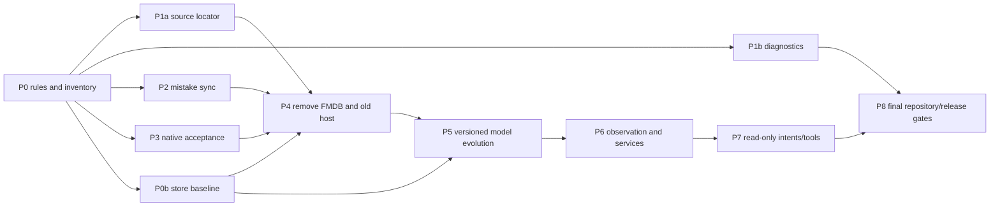

# Swift and SwiftData migration specification

Updated October 20, 2026. Status: specified for staged implementation; acceptance gates remain open. This is the execution specification for the remaining modernization. [TASKS.md](TASKS.md) tracks current status; historical validation receipts remain evidence for their stated source and scope. A plan item is complete only after its acceptance gate passes. FMDB removal and complete feature parity are still open.

## Outcome and boundaries

Ship one shared SwiftUI application for iPhone, iPad and native Mac, using Swift 6 and SwiftData for durable app data. Preserve WaniKani grading, lesson order, review options, offline work, notes, exclusions, account identity and synchronization. Retain WaniKani colors, system typography and SF Symbols, with restrained native Liquid Glass. The original Tsurukame iPad lesson/review flow remains the interaction reference. Changing frameworks must not silently change study behavior.

The repository stays in `apps/usagiunagi`, with localized 兔鰻/usagiunagi identity. Work remains on the existing development branches, with commits and no PRs or pushes. Mainboard owns development dependencies, formatters, rules, builds, tests and receipts. App-specific task scripts must not grow into a second development system.

FMDB is to be removed from app source, target membership, dependency declarations and linked products. The old custom SQLite database still needs a read-only import path for supported existing installations. That boundary must use the system reader, be isolated from feature code, and never remain a second writer. SwiftData cannot interpret arbitrary legacy FMDB tables as a native model store. Its own [default store uses Core Data internally](https://developer.apple.com/documentation/swiftdata/defaultstore); the requirement is to eliminate our handwritten feature SQL and FMDB dependency.

Durable domain data belongs in SwiftData. Credentials stay in Keychain, ordinary preferences in AppStorage/UserDefaults, transient window input in SceneStorage, and downloaded media in files. These storage roles preserve platform behavior and avoid storing credentials or large media blobs in model records. WaniKani remains the authority for assignment/review progress. CloudKit must not independently replicate the answer outbox.

## Current implementation

The production scene already uses `UsagiUnagiApp` → `StudyApplicationOwner` → `StudyAppAssembly` → shared `StudyRootView` on all three platforms. `StudyStore` is an `@ModelActor`, uses SwiftData transactions and returns Sendable values. Shared modules use Swift 6.4 tools and Swift 6 language mode. The main app deployment floor is iOS/iPadOS/macOS 27; retained iOS/watch targets still include Swift 5 settings, and watchOS remains at 9. P8 must resolve those boundaries explicitly rather than claiming the entire built product already uses Swift 6. Normal iOS bootstrap reads old installations through `LegacyStudyImporter`, which already uses system SQLite3 read-only; its source URL now comes directly from the importer-owned locator without referencing the native-retired writer. The old cache temporarily delegates its compatibility path method.

The remaining DEBUG acceptance host constructs `TKMServices` and the old cache/writer. Old controllers are also still compiled for iOS. Removing only their launch route would leave source and dependency debt. Native recent-mistake practice reads local account progress; its cross-device replacement is an unwired prototype, so the original timestamp service still belongs to `LocalCachingClient`. Native diagnostics now exports account-scoped typed SwiftData values through Apple data transfer. `SQLiteDiagnosticArchive` remains only at the old-host boundary for `local-cache.db` and its retained tests; original stores and recovery responsibilities have not been removed.

Shared grading, kana conversion, session policy, sync/recovery, lessons, reviews, subjects, settings, Home and charts are implemented. The current shared suite passes on both Mac and iOS: 508 tests in 69 suites, comprising 227 core, 196 persistence, seven speech and 78 UI/model functions. Native diagnostic sharing also passes on Mac, iPad and iPhone; three offline-audio cases now use the production native scene and pass on iPad and iPhone. [The diagnostics and parity receipt](Validation/2026-10-20-native-diagnostics-and-parity.json) records the exact source, destinations and results; five separate-process persistence probe phases (`write`, `read-attempts`, `write-catalog`, `read-catalog` and `read-native-baseline`) also pass on disposable data. Prior 479/491-function runs remain historical evidence. Physical Japanese IME, microphone/model behavior, signed upgrades, OS notifications/background work and paired watch transfer still need device evidence. Bundled free levels contain display references, not a complete authenticated exercise catalog.

## Evidence and decision baseline

The implementation baseline is app commit `fa3c3ddf265b9ce1acd78ef74a0d59eb2f20ccc8` and Mainboard `5796a2e2b3b39e86642591eb4f8ca4e9dff36561`. Counts below describe that committed source, not a promised final shape. P1a subsequently isolates the source locator and removes FMDB from importer fixtures; [its receipt](Validation/2026-10-20-legacy-importer-without-fmdb.json) records nine hosted importer and 24 shared bootstrap functions passing. Later phases remain open; this evidence does not authorize a data reset or establish full FMDB removal. P0b now freezes the exact committed native writer in a synthetic 218,485-byte fixture; pinned/current separate-process readers restore all 38 records across ten model types and two accounts. [Its receipt](Validation/2026-10-20-native-store-baseline.json) scopes this to macOS baseline/reopen evidence, with future versioned/iOS upgrades still open.

Source inspection found ten native model types and fifteen `.codable` attributes. In particular, `AccountRecord` contains the progress/statistics collections, `AssignmentRecord` wraps an assignment, and `SnapshotRecord` is keyed by a credential fingerprint. These are the starting points for modeling work, not a reason to create a second database abstraction. Reuse the existing `StudyStore` actor and four shared modules.

Apple documentation was checked on October 20, 2026, against the installed Xcode 27 SDK. The Mac SwiftData interface also declares ResultsObserver, HistoryObserver and the codable attribute option. API existence is verified; integration behavior still needs the tests below. Third-party articles about “2027” are not API contracts.

| Capability | Verified availability or limitation | Decision for this app |
| --- | --- | --- |
| Custom Codable attributes | Apple introduces `.codable` for types that cannot otherwise be modeled; encoded contents cannot be queried/sorted and payload changes do not trigger schema migration | Treat current app-owned blobs as migration debt. Prefer supported value types or models for owned data; reserve opaque encodings for justified immutable envelopes/external types. [Apple session](https://developer.apple.com/videos/play/wwdc2026/274/) |
| ModelActor | Available since iOS 17/macOS 14; serializes access to its model context | Keep the existing owner. Recheck account/revision after every suspension; actor isolation does not replace transaction or request-order guarantees. [ModelActor](https://developer.apple.com/documentation/swiftdata/modelactor) |
| Observation | ResultsObserver and HistoryObserver require the 27 releases; their roles are query results and persistent-history changes respectively | Prototype against one real projection before replacing existing listeners. Never equate a history event with server acceptance. [ResultsObserver](https://developer.apple.com/documentation/swiftdata/resultsobserver), [HistoryObserver](https://developer.apple.com/documentation/swiftdata/historyobserver) |
| Schema evolution | VersionedSchema and SchemaMigrationPlan describe explicit model versions and migration stages | Freeze the current store fixture before any model declaration changes; verify an actual upgrade, including the current unversioned store. [VersionedSchema](https://developer.apple.com/documentation/swiftdata/versionedschema), [SchemaMigrationPlan](https://developer.apple.com/documentation/swiftdata/schemamigrationplan) |
| AI and system actions | Foundation Models calls an app-defined Tool; AppIntent exposes an app-defined action | Add explicit bounded read adapters later. Do not assume SwiftData exposes the schema automatically or let generated output grade answers. [Tool](https://developer.apple.com/documentation/foundationmodels/tool), [AppIntent](https://developer.apple.com/documentation/appintents/appintent) |

## Checkpoints and current validation

Acceptance applies to the stated source and scope. The app branch is `codex/swiftui-27-curriculum`. App checkpoint `01be7a38` accepts P1b typed diagnostics and selected P3 parity at the scope recorded below; P0b remains scoped to `8669eca8` and P2 remains an unwired tested prototype. The current checkpoint uses Mainboard `41c27749cddc49ff0d07085db92037b5ae940d70`; [the diagnostics and parity receipt](Validation/2026-10-20-native-diagnostics-and-parity.json) records its source-specific validation. The open gates below still control production adoption and deletion. The current receipt-scoped production Swift inventory grows from 31,828 physical lines at `d1311630` to 31,993 (+165), including typed diagnostics; no LOC reduction is claimed. No push or hosted Actions pass is claimed.

| Phase | Status at this review | Next evidence required |
| --- | --- | --- |
| P0 | Current parser, formatter, correctness checks and eleven-rule inventory; current Mainboard commit `41c27749cddc49ff0d07085db92037b5ae940d70` | Reconcile the final caller/resource inventory and rerun against the final source; publish tooling only when authorized |
| P0b | Accepted at `8669eca8`: frozen native store, exact schema/values and Mac process reopen | G7 still needs a real versioned upgrade and iOS execution; never regenerate the fixture to make a migration pass |
| P1a | Accepted at `ee25d32f`: importer locator and FMDB-free fixture writer | Retain G1/G2 as deletion regressions |
| P1b | Accepted at `01be7a38` for account-scoped typed diagnostics and Apple data transfer: five focused functions pass in the Mac/iOS shared suites; native sharing UI passes on Mac, iPad and iPhone | Preserve the receipt’s runtime/Release limits and the legacy SQL backup helper until its last old-host caller and tests retire |
| P2 | Seven-file tested prototype at `d1311630` remains unwired; all sixteen focused tests pass on Mac and iOS, including strict unknown-field rejection; lint/parser gates pass | Resolve Apple identity fencing, durable legacy binding/revocation, whole-key convergence and signed shared namespace before production integration or old-service removal |
| P3 | Four review IDs ported and two negative fixture cases retain their scoped evidence; `launchSingleReview` has zero callers. Three offline-audio cases now use the production native scene and pass on iPad and iPhone | Port the remaining 25 old-host UI cases and hosted notification/storyboard invariant; retain all nineteen writer mappings and finish the remaining platform/runtime gates |
| P4–P8 | Planned; not accepted | Follow the dependency graph and the gates, with separate commits for deletion and schema evolution |

The current declared five-case details gates pass on both phone and iPad, but each structured result records four “Invalid frame dimension (negative or non-finite).” runtime warnings. The repeated message provides no usable source stack; neither an app calculation fault nor a framework defect is established. Keep this runtime gate open and record its source/result scope in the current receipt; no unqualified clean UI result is claimed. The earlier iPad diagnostic share-dismissal query failure is resolved by current sharing acceptance. Removing the extra center tap also restores the focused feedback/draft-preservation case on both iPhone and iPad. Earlier review receipts retain their exact scope; passing these cases does not authorize whole-host or dependency deletion.

## Requirements

| ID | Required result | Completion evidence |
| --- | --- | --- |
| M1 | One production SwiftUI feature implementation across iPhone, iPad and Mac | Shared screens and state, native builds and equivalent end-to-end flows; platform conditions confined to a documented capability boundary |
| M2 | SwiftData owns durable application state and every normal write | Native schema/store APIs, account-isolated queries, atomic session/outbox transitions, no FMDB linkage or feature SQL |
| M3 | Existing work survives migration and restart | Real historical schema fixtures, current-native store upgrades, interrupted handoff/restart tests, immutable original source retained on failure |
| M4 | Lesson/review behavior is preserved | Typed/Anki/voice, incorrect/correction/defer/wrap-up, draft pause/resume, lesson teaching/quiz and missed-subject results verified against existing policies |
| M5 | Cross-device and background behavior has one owner | Timestamp merge, notifications, background scheduling, links and watch transfer fed from committed native state, with logout/cancellation/account-change tests |
| M6 | Statistics remain understandable and credible | Shared plots, verified coverage lists, forecast/backtest validation and explicit separation of coverage from exam pass probability |
| M7 | Rules guide future cleanup without inventing semantics | Syntax-backed Swift checks, current-toolchain compilation, correctness lint, documented exceptions and official remediation links; no silent skipped source |
| M8 | Repository and CI stay small and reproducible | Dependency/task ownership in Mainboard, generated/vendor exclusions, deleted obsolete targets/resources, local passing receipts and authorized publication before hosted CI claims |

## Target architecture

Keep the existing four shared modules. Do not create parallel iOS/macOS feature folders or duplicate view models.

| Location | Responsibility |
| --- | --- |
| `App/UsagiUnagiApp.swift` and `App/Application` | App identity, one service graph, scene lifecycle, entitlements and platform composition |
| `Shared/Sources/StudyCore` | Sendable domain values, grading, kana/session policy, API contracts and deterministic statistics |
| `Shared/Sources/StudyPersistence` | SwiftData models, actor-owned queries/transactions, outbox/recovery, typed export and isolated read-only migration |
| `Shared/Sources/StudyUI` | Shared SwiftUI features and Observation state; narrow UI bridges live beside the feature that requires them |
| `Shared/Sources/StudySpeech` | Speech/recording lifecycle and typed transcripts; grading remains in StudyCore |
| `Resources` | Required assets, licensed reference catalogs and genuine offline fixtures; development generators use Mainboard |
| `Docs` | This specification, current task ledger, architecture decisions and scoped validation receipts |

Adapt layout to window size, content, accessibility and native presentation. Use compile-time platform checks for APIs that actually differ: microphone/audio session policy, WatchConnectivity, system settings, background refresh and window/menu configuration. A separate operating-system check must not create a second lesson/review implementation.

## Persistence contract

### Ownership and transactions

Use one model-container/actor owner for a store. ModelContext and live model objects do not escape that executor. UI, intents and future model tools receive immutable Sendable values or stable identifiers. Network requests and account verification run outside save transactions. Recheck account identity, generation and expected revision after suspension before committing.

A graded answer and the corresponding session advance/outbox record must commit together. A crash may leave the prior question or a fully committed new state; it must not lose an answer or duplicate an upload. Mark an attempt durably before sending. A timeout or uncertain server result stays pending for explicit reconciliation; it is never automatically replayed just because the process restarted. A successful WaniKani response and local acknowledgement remove work only for the matching revision. Material conflicts retain the local note and original revision until the person chooses a resolution.

Logout, token replacement, account switching and vacation must cancel or invalidate the relevant work, preserve unresolved data for the correct account and prevent an old task publishing into the new account. Multiple windows share the same store owner and cannot create competing writers.

### Schema and Codable values

Create a named VersionedSchema and SchemaMigrationPlan before the next stored-schema change. Preserve identifiers and outbox semantics during migration. Test opening a store written by the current committed app; an empty new store is insufficient evidence.

| Data | Model/query requirement |
| --- | --- |
| Account/profile | Stable verified account identity; token fingerprint where needed, never the token; account-scoped preferences/state |
| Catalog | Subject identity, level and searchable/groupable fields as model attributes; exact typed subject content retained |
| Assignments/progress | Queryable account, subject, due date and SRS state where measured hot paths need them; recent mistakes retain timestamps without inventing review events |
| Active session | Selected items, policy/options and revision preserved; transient text remains scoped to the matching window/session/question |
| Review/material outbox | Original payload, identity, revision, attempt marker and recovery/conflict information preserved atomically |
| Import receipt | Source identity/digest, verified destination and completed handoff phases retained durably |
| Statistics | Deterministic projections of saved verified progress; no independent authoritative progress copy |

The store already uses `@Attribute(.codable)` extensively for app-owned types. Apple recommends supported value types or models for owned data rather than using this escape hatch by default. P5 must audit all fifteen attributes, record each replacement or explicit retention reason, and remove serialization wrappers where SwiftData can represent the value directly. Keep immutable historical request/recovery envelopes exact while converting them; do not reconstruct them from a newer catalog. Codable payload shape changes require compatible decoding and are not automatically handled as model-schema migrations. Query and index only fields with an actual use; avoid turning every nested detail into an independently owned record.

### Model evolution and operation contracts

This is the proposed logical model; exact Swift declarations must be proved by the migration prototype. Preserve existing entity identities until an old-store upgrade passes. Do not rename entity classes and reshape their payloads in the same first migration.

| Current owner | Target representation and invariants |
| --- | --- |
| SnapshotRecord | Rebuildable display projection associated with a verified account. Account identity must not depend solely on the current token fingerprint; token rotation cannot orphan work. No raw credential is stored. Retain its compatibility reader until old stores reopen correctly. |
| AccountRecord | Stable unique account ID and typed profile/cursors. Move per-subject progress and growing statistics collections out of the whole-account opaque payload in measured steps. Keep one authoritative copy and rebuild display snapshots after conversion. |
| CatalogRecord | Account/subject composite identity; explicit searchable/groupable fields, with supported typed subject details. Preserve accepted/auxiliary answers, readings, restrictions, mnemonics, context, components, media and hidden/access metadata losslessly. A count-only catalog comparison is insufficient. |
| AssignmentRecord | Account/subject identity and local revision; native due date, stage, hidden/availability and server identity fields for queue queries. Compare exact queue membership/order before replacing the current projection. |
| Proposed progress/statistics records | Stable account/subject or server-record identity; native mistake timestamp, original local-time source where ambiguous, SRS state and answer/streak counters. Retain recorded resets, duplicate-history handling and missing-value distinctions. |
| SessionRecord | One saved active session per account with its revision. Preserve selected order, both answer sides, first-wrong flags, retry/defer/wrap state and options; never rebuild an interrupted queue from new settings. |
| ReviewRecord | Account/subject uniqueness, exact original item/assignment/submission, local revision, attempt marker and issue. Optional original assignment stays optional; migration cannot invent evidence of delivery. |
| MaterialRecord | Account/subject uniqueness, server ID, exact notes/synonyms, revision, pending state, attempted revision/payload and recovery baseline. “Not checked” and “checked and missing” remain different values. |
| ImportReceipt | Exact source identity/digest, verified account binding, handoff phase and compatible preference snapshot. Global native-writer selection and unbound import receipts are not casually reassigned to an account. |
| UploadPauseRecord / ArchivedReviewRecord | Durable retry deadline and exact local resolution archive. Archiving is not a server acknowledgement and cannot make stale assignments reviewable. |

Enforce identities with native uniqueness declarations and actor validation. Explicitly choose delete rules for any introduced relationships. Refresh may replace clean server data; it cannot cascade-delete dirty notes, saved sessions, pending/attempted work or recovery evidence. Account logout follows the existing explicit preservation/removal policy, not an implicit relationship cascade.

| Operation | Required atomic boundary and suspension checks |
| --- | --- |
| Commit an answer | Validate account and expected session revision; save the graded session, new outbox item and local mistake information together. No network request occurs inside the transaction. |
| Send pending work | Capture exact revision/payload; durably mark the attempt before the request. On return, recheck generation/account and acknowledge only that revision. A newer edit survives. |
| Apply a download | Verify account, endpoint and captured generation; reconcile against revisions captured before the request. An older response cannot restore an acknowledged assignment or overwrite a newer/changed-back note. Commit resource rows and cursors together. |
| Edit materials | Compare expected revision, including explicit absence. Preserve concealed fields. A conflict returns a typed error/comparison and keeps the editor draft; only an explicit replacement choice can overwrite the current value. |
| Switch account / disconnect | Cancel and drain owned work before changing credentials. Invalidate late results and observation tasks. No old account's state may be published or sent under the new credential. |
| Export / observe | Read committed values on the owning actor. Export performs no save/acknowledgement; observers have explicit lifetime and account cancellation. |

First freeze a disposable on-disk fixture from the committed native writer, with all ten record types and both accounts populated. Record its writer revision, schema metadata and expected domain values. Prove that the first named schema accepts that actual unversioned store before changing fields; assigning a version number alone is not upgrade evidence. Then change one group at a time: query fields/indices, progress/statistics ownership, supported values, and any cache cleanup. Decode old payloads before removing their declarations. Test each supported version directly to latest and repeat opening the migrated result.

If a compatible in-place stage cannot be established, stop that phase and specify a separate SwiftData-to-SwiftData conversion into a different store, with source retention and the same recoverable writer handoff. Do not silently substitute this path or erase the failing store. A model-open error must never invoke delete-and-recreate recovery.

### Observation

Replace custom event plumbing with ResultsObserver only after a prototype proves equivalent behavior. Keep observation on the owning actor and convert results to Sendable projections there. Check local writes, second-context commits, rollback, deletion, cancellation, logout, account changes and reopening. A rollback must not announce a committed state. Observers must not retain dead windows or publish an old account’s data.

Evaluate HistoryObserver for actual external/context writers and restart catch-up. Persist history tokens where needed, filter authors, process each transaction idempotently and test replay after a crash. A history notification wakes reconciliation; it is not proof that WaniKani accepted an answer. Avoid adding both observers and the old listeners indefinitely: delete the replaced path once parity is proven.

Apple documents [ResultsObserver](https://developer.apple.com/documentation/swiftdata/resultsobserver) and [HistoryObserver](https://developer.apple.com/documentation/swiftdata/historyobserver) in the 27 releases. [ModelActor](https://developer.apple.com/documentation/swiftdata/modelactor) already existed in earlier systems and does not make logical races across suspension impossible. The [official SwiftData session](https://developer.apple.com/videos/play/wwdc2026/274/) covers Codable limits, sectioned queries and observation.

## Migration and deletion sequence

Each phase is a reviewable checkpoint. Commit after its gate passes; no phase claims completion from a build alone. Preserve unrelated owner edits. Do not combine broad deletion, a schema rewrite and UI redesign into the same checkpoint.

| Phase | Change | Required gate before proceeding |
| --- | --- | --- |
| P0 Rules and inventory | Finish current-toolchain Swift parsing, correctness/formatting checks, migration signals, official guidance and an exact caller/dependency inventory | Real app scan covers all selected source; positive/negative rule tests; no source skipped silently; required CI commands work standalone |
| P0b Freeze native-store baseline | Capture the exact current unversioned schema, populated store and domain expectations before model edits | Fixture opens with the committed writer; all ten record types, account boundaries, uncertain work and revisions are represented; native schema evolution cannot start without it |
| P1a Isolate legacy source location | Extract the database URL locator from LocalCachingClient; document the remaining import-only boundary | Clean install and old-install bootstrap/reopen preserve exact source discovery without constructing the old writer |
| P1b Native typed diagnostics | Replace native diagnostic sharing with a consistent SwiftData export; retain recovery responsibilities and retire old-host export with its final caller | Complete export without credentials during concurrent saves; cancellation/failure leaves the store intact. This is required for removing feature SQL, not technically for removing FMDB |
| P2 Native recent mistakes | Move cross-device timestamp merge and lifecycle ownership to native services | Fake cloud store tests for account isolation, latest timestamp, 24-hour window, malformed archives, startup catch-up, logout, simultaneous local/cloud changes and no feedback loop; native practice counts update without review uploads |
| P3 Retire legacy acceptance and UI owners | Port remaining feedback/milestone, details/conflict, login/account, Home/catalog, practice/voice, settings/audio and refresh cases to the production scene | Equivalent behavior cases on native Mac/iPhone/iPad, with local synthetic services; production routes never construct the legacy host |
| P4 Delete FMDB and old writer | Remove LocalCachingClient, PendingUploadStore, SyncStore, old TKMServices/controller callers, FMDB helpers and obsolete generated storyboard accessors/resources once their final callers are gone | Zero app-owned FMDB import/reference/dependency/linked product; current-native reopen/historical-source import and crash/restart gates pass; all required builds/tests pass |
| P5 Evolve native schema and queries | Add versioned migration, measured query fields/indices and sectioned projections | Before/after queue/count/chart equality, current-store upgrade, full-catalog performance comparison, rollback/recovery, no duplicate durable source of truth |
| P6 Simplify observation and services | Adopt native observers where they replace existing work; finish native watch/notification/background integration | No duplicate wake/upload loop, no stale-account publication; resolve current SDK scheduling deprecations without changing delivery semantics; automated lifecycle checks plus required physical delivery/expiration evidence |
| P7 Read-only intents and AI tools | Expose bounded typed search/focus/coverage/forecast queries through explicit adapters | No credential/raw ModelContext exposure; availability fallback, cancellation, bounded queries and no ability to grade/send/acknowledge answers |
| P8 Repository and release gate | Remove unused files/dependencies/targets and finish Swift 6 mode for app-owned code; verify standalone Actions and distribution configuration | Clean checkout dependency restore, native Release builds, full automated gates, signed-upgrade/device acceptance; publish only after explicit push/distribution authorization |

P0b can follow P0 independently of the no-schema-change work. P1a, P1b and P2 may progress independently after P0. P3 can progress alongside them. P4 requires P0b baseline/reopen proof plus P1a, P2 and P3 to pass; it cannot be replaced by marking old files DEBUG-only or renaming a wrapper around FMDB. P1b is independent of the FMDB dependency and remains necessary for M2’s removal of feature SQL. P5 requires P0b and P4 and must not destroy the source/import evidence still needed by supported installations. Voice usability, statistics calibration and native watch work can run independently while these storage phases proceed.

### FMDB caller and dependency removal

After accepted P1a, the current direct imports are four runtime adapters (`LocalCachingClient`, `PendingUploadStore`, `SyncStore`, `FMDatabase+Assert`) and two hosted-test files. No app-owned Objective-C implementation/header files remain tracked; Objective-C still arrives through installed dependencies. A source-extension count alone cannot establish a Swift-only built product.

| Caller or dependency | Replacement or removal condition |
| --- | --- |
| Original source locator | Accepted P1a: production uses `LegacyStudyImporter.databaseURL`; the old cache delegates only its compatibility accessor. Keep exact source discovery covered when deleting that accessor |
| DEBUG Screenshotter/AppDelegate/TKMServices/legacy coordinator | Move its remaining acceptance callers to injected production services before deleting the host and its controllers |
| `LegacyStudyImporterTest` | Accepted P1a replaces its FMDatabase writer with system SQLite3; retain all nine functions and their malformed/WAL/schema cases |
| `PendingUploadAcknowledgementTest` and `SyncStoreTest` | Map their four plus fifteen test functions to native outbox/synchronization invariants, verify the replacements, then delete the old writer-specific tests |
| Native diagnostics and `SQLiteDiagnosticArchive` | P1b supplies account-scoped typed diagnostics with passing Mac/iPad/iPhone sharing acceptance. The SQL helper remains only for the old-host `local-cache.db` boundary and retained tests; preserve recovery responsibilities and retire it only with its final caller |
| Podfile and Podfile.lock | Remove FMDB, restore locked integration and inspect the resolved dependency graph; avoid unrelated dependency updates |
| Project/framework integration | Remove stale FMDB build/link/embed references and verify each destination’s linked product; retain required remaining CocoaPods integration until its other callers retire |
| SQLite3/protobuf legacy reader | Preserve its supported source conversion independently of FMDB; it already has no FMDB import |

FMDB removal does not by itself retire Reachability, SwiftGen, Hippolyte, SVGKit or their transitive dependencies. Audit each final caller separately, then remove the dependency and stale build resources at the same checkpoint. Keep source licenses and historical receipts.

### Native recent-mistake service (P2)

This phase moves ownership, not study semantics. Recent mistakes are timestamps used to select Extra Study; merging them must not create a graded answer, alter a WaniKani assignment, advance SRS, or enqueue an upload.

The current wire key is `<username>tsurukame-mistakes`; its Data contains a JSON string dictionary of subject IDs to local `yyyy-MM-dd HH:mm:ss` strings. The old code also writes a global `lastSyncCall`. Preserve compatibility while existing clients need it. The old formatter also leaves locale/calendar implicit. Without that metadata the archive cannot establish a precise cross-zone/calendar instant. Preserve original text and test legacy interpretation, including non-Gregorian settings; do not claim conversion recovers missing information.

Native wire contract: key `usagiunagi.mistakes.v1.<verifiedAccountID>` and a binary-property-list envelope with `formatVersion: 1`, matching `accountID`, and sorted entries of positive `subjectID: Int64` and nonnegative Unix-second `timestamp: Int64`. Reject missing identity, duplicates, invalid values, unknown versions and unknown fields at every level without rewriting the source. Future producers must bump the format version when extending its shape. The prototype now rejects unknown fields at the envelope and every entry level; direct decoder and cloud no-rewrite cases pass in both shared test destinations. A persisted binding records the original username, explicit locale/calendar/time-zone interpretation, stable account ID and exact activated source receipt/digest. Capture it only during a newly verified source handoff; old receipts cannot acquire it by inference. A verified username change durably revokes that legacy binding, including after restart or rename-back. The tested prototype only injects a binding and has no durable capture/revocation; production legacy access must remain disabled until those states and their upgrade tests exist. Import/observe that legacy key only under the matching binding; fresh accounts cannot claim an arbitrary username archive. Rename/reuse cannot change the stable native key or transfer its binding to another account. Keep old keys intact; any compatibility writes must be limited to a proven binding and tested against legacy encoding. A username-only archive cannot conclusively establish historical ownership, so unattributed data remains a recoverable legacy source rather than being silently assigned. Apple-account change invalidates cloud tasks/buffers, not local WaniKani study history. Validate old/new-key coexistence, duplicate idempotence and restart after partial handoff before retiring the original service.

Put timestamp parsing/merge policy in a shared deterministic value service and local application in `StudyStore`; put NSUbiquitousKeyValueStore interaction/lifecycle in an app-owned adapter. Use a small injected store contract in tests, not a subclass of Apple's store. Production explicitly injects the real default store; synthetic fixtures never acquire it by default. Register the external-change listener before initial catch-up, coalesce committed local/external changes, and cancel/rebind at account changes.

Merge the maximum timestamp per supported subject. Retain the original 24-hour boundary and explicitly test DST, changed time zones, clock rollback and future values. Do not reinterpret future timestamps as a new mistake now. Practice eligibility follows the common StudyAvailability policy. Cloud entries cannot fabricate a catalog/assignment or previously unknown progress record; preserve/reconcile supported local identities and keep the cloud archive intact when an entry cannot yet be applied. Do not age entries out of durable history merely to trim the cloud payload.

Whole-document malformed data is a recoverable error, not an empty successful read followed by an overwrite. Define and test invalid individual-entry handling separately. Write only when the canonical merged payload changed; a merge with no local changes emits no store transaction. A self-write cannot trigger an unbounded read/write/notification loop. Recheck verified account ID, username/key and lifecycle generation after every await.

Test initial/server/account/quota notification reasons, logout during a read/write, WaniKani username rename/reuse, two WaniKani accounts, an Apple-account change independently of WaniKani identity, a simultaneous local answer/cloud update, same-second ties, unknown IDs, missing entitlements and no Apple account. Keep local practice working when cloud delivery is unavailable. Apple's key-value store is asynchronous and bounded (1 MB total, 1024 keys, 128 UTF-16 units per key); validate key/payload size before writes and do not equate a local synchronize call with confirmed remote delivery. [Apple's store contract](https://developer.apple.com/documentation/foundation/nsubiquitouskeyvaluestore) defines these limits.

Source audit found an additional delivery gate: iOS uses `$(TeamIdentifierPrefix)$(CFBundleIdentifier)` for the cloud namespace; the separate Mac entitlements file currently has no ubiquity key. The platform bundle identifiers also differ. Before claiming cross-device delivery, define an owner-controlled shared namespace and verify signed entitlements on both products. Do not assume the fork can access upstream Tsurukame's iCloud or Keychain identity. This gate is independent of passing fake-store tests; never test it by writing to the person's real cloud account.

Two further design decisions block production adoption. First, an `available: Bool` plus a delayed account notification cannot fence a switch between two signed-in Apple accounts during an await. Define and test account-generation invalidation at the adapter boundary, including a switch before the event is consumed. Apple's [ubiquityIdentityToken](https://developer.apple.com/documentation/foundation/filemanager/ubiquityidentitytoken) represents iCloud Drive Documents identity; it is not established here as KVS account status. A nil-token guard is a conservative refusal, not proof that KVS is unavailable. Do not add CloudKit or Drive entitlements just to manufacture a status check.

Second, KVS offers no compare-and-swap or atomic cross-device maximum merge. Rereading before a whole-key write narrows a race but cannot eliminate it. SwiftData remains the durable local authority; cloud values are best-effort practice hints, never proof of delivery. Test two disconnected devices, concurrent disjoint and same-subject changes, overwritten updates and later reconciliation. Retain unapplied/unknown entries in the merged archive. If the required convergence cannot be demonstrated, keep P2 open and specify a different native transport before deleting the old service; do not claim guaranteed cloud preservation from a final reread.

Preserve ambiguous legacy local-time text even when an absolute native timestamp is available. The absolute timestamp governs native recent-mistake eligibility; retain the text as recovery evidence rather than inventing a recovered historical instant. Missing interpretation metadata and DST folds remain explicit uncertainty. Test that precedence, no-clock-reinterpretation behavior, and read-only recovery of malformed entries.

Production integration belongs in the existing assembly/owner: explicitly inject Apple's default store only for a real account, start one worker after native restore, wake on foreground, stop/cancel on teardown and rebind on verified identity changes. Present unavailable/quota/error state inline without a repeating modal; local practice must remain usable. Synthetic fixtures receive only protocol fakes. Test coexistence with the existing automatic review sender and multiple windows, with no second writer or upload loop.

### Diagnostics and recovery copies (P1b)

P1b interface: `StudyStore.diagnosticDocument(accountID:)` returns one versioned Codable/Sendable projection; `StudyDiagnosticArchive(store:accountID:)` provides export-only Transferable conformance. The production native root composes it from the verified non-sample account and existing store. No database URL, second container, credential-store access, alternate writer or permanent duplicate snapshot is needed. Five focused functions pass in the Mac/iOS shared suites, and native sharing UI passes on Mac, iPad and iPhone; the current receipt records exact source/runtime/Release scope at `01be7a38`.

The actor must fetch the whole projection without suspension so it represents one committed state relative to the single app writer. Encode binary property-list Data off that actor; use Apple `DataRepresentation(exportedContentType: .binaryPropertyList)` with a unique suggested filename so the framework manages transfer publication and lifetime. Do not add an app temporary-file cache or a custom file-transfer wrapper. Profile large exports before choosing a more complex representation. Export must preserve:

| Content | Required detail |
| --- | --- |
| Account and display data | Profile, progress, statistics, cursors, SRS definitions, levels, voices/audio references, and selected account's cached projections; omit credential fingerprints |
| Catalog and assignments | Exact typed subject/assignment values and local assignment revisions |
| Saved session | Full queue, question/answer state, options and revision |
| Review outbox | Exact submission/original item/original assignment, revision, attempt marker and issue |
| Material outbox | Notes/synonyms, server ID, revision, pending/attempted payloads, issues and recovery baseline, including observed absence |
| Recovery and handoff | Archived reviews, retry deadline, source digest and verified account-bound handoff status; exclude credential IDs and private preference payloads |

Import receipts currently mix account-bound, unbound and global writer-selection records. Include only receipts with verified ownership. The format always declares unbound/global receipts out of scope; it must not inspect or count another account's records to report their presence. Do not parse ownership using a loose account-prefix match or export all receipts. If complete recovery requires these records, specify a separate private recovery format rather than weakening diagnostic account isolation.

Label the control “Export study diagnostics” and state that notes and pending work are included. Exclude app-managed API tokens, Keychain contents, credential fingerprints, other accounts, preferences, media bytes and app-private path metadata. User-authored notes remain exact as disclosed; this is not a universal secret/path-redaction format. Do not upload automatically. A document selected for one account cannot be replaced with another account's data while sharing. Cancellation/encoding failure must not yield partial Data or change durable study state; Apple handles the transfer destination and its errors. Each completed export is an immutable independent artifact. Repeating a later export may capture newer committed data for the same fixed account; it must never switch account identity.

A typed diagnostic document is not a restorable database backup. This change can replace diagnostic sharing only if that is the current feature contract; it cannot silently remove recovery/backup capability. Keep original source stores and the existing legacy WAL-safe backup path while its callers/tests remain. If user-restorable backup is required, its restoration must be a separate account-verified, versioned feature with no automatic replay of attempted work. Do not offer Import merely because Export exists.

### Original-data handoff and recovery

Source access has two distinct supported cases. A same-identity installation upgrade can discover its original file in its own container. A separately signed fork cannot assume access to upstream Tsurukame's sandbox, Keychain or cloud namespace. For that case, specify a user-selected exported source/document route and security-scoped access, with supported schema validation and the same account verification before import. No automatic cross-sandbox extraction is part of this plan. Confirm source availability/export capability before claiming original-app migration; if none exists, keep that distribution gate open and preserve the original app/data. Independent branding or a new bundle ID does not grant access to the old container.

1. Open the old source read-only, including committed WAL state, and identify its supported schema and account.
2. Capture immutable source bytes/metadata and validate grading inputs, pending work, notes and progress. Do not call Settings getters that mutate old defaults.
3. Verify the destination account using the existing read-only account capability. Do not place the API token in a receipt, fixture, export or log.
4. Import all related records and a source receipt in one native transaction. A repeated import must not recreate consumed pending work. Preserve the existing conservative rule: imported pending reviews are marked attempted and pending notes uncertain because the old queue cannot prove delivery. Import must not make them automatically uploadable.
5. Save/verify credentials and activate the native-writer choice through the existing recoverable handoff sequence. Resume from durable phase state after interruption.
6. Hydrate only absent native preferences; later native edits win. Keep compatible media directories where possible.
7. Reopen in another process, verify counts/revisions/payloads and exercise one synthetic offline review and material change.
8. Keep the original source on error. Unsupported or malformed data opens recovery UI and must not silently create an empty replacement account or restart the old writer after native activation.

Signed Keychain/upgrades remain a physical acceptance gate even when disposable fixture handoffs pass. Historical source schemas 9–15 and interrupted WAL/protobuf cases must remain supported by tests until an explicit supported-upgrade policy replaces them.

### Handoff state machine and failure policy

Keychain, SwiftData and preferences are separate persistence systems; there is no cross-system atomic transaction. The existing handoff deliberately uses durable phases. Keep this behavior explicit:

| Durable condition | Permitted next action | Restart/failure behavior |
| --- | --- | --- |
| No selection / no legacy credential | Select a fresh native writer durably | A later logout/reopen never discovers a stale legacy token and changes the writer choice |
| Unselected legacy installation | Read a consistent source, verify identity, reread and compare token/digest/preferences | Offline/invalid identity or source change preserves source and blocks activation; it cannot masquerade as a fresh install |
| Imported receipt, no bound handoff yet | Reverify identity and finish binding to the exact source digest | Idempotent import cannot recreate a consumed pending item; do not assume an unbound receipt authorizes credentials or a writer |
| Prepared/bound, not activated | Verify the same source/credential; save a missing matching credential, re-read it, then activate | Credential failure/conflict retains prepared data. Never overwrite a newer credential. A valid prepared binding can resume with its existing verified identity under the current protocol |
| Credential saved, activation missing | Recheck binding/snapshot and commit activation | The crash window is resumable; a saved token alone cannot choose a writer |
| Activated, preferences not hydrated | Restore only absent compatible preferences from the receipt | Retry without reading retired source/token/network; preserve subsequent native choices |
| Activated / subsequently logged out | Restore native services or native sign-in only | Never reopen the legacy writer or reimport its stale queue |
| Unsupported schema, corrupt store, source mismatch or inconsistent receipts | Show recoverable failure with a bounded explicit retry | Keep source and destination. Never reset, silently start empty, retry uploads or reopen old writer |

Inject interruption before/after every durable phase in disposable stores and reopen in a separate process. The existing probe already exposes import/save/activate/preference and fresh-selection phases; extend it for new states rather than building another app-local harness. Preserve committed WAL reads without checkpointing/truncating or replacing the source file. Keep original data on failure; source disposal is outside this migration until a retention policy is specified.

A code rollback is safe only before native activity, or to a build that understands the same native schema/outbox. Reinstalling an old writer after new answers have been saved risks two divergent queues. A gate failure stops the phase and preserves the working native version; it is not permission to downgrade data or copy the old database over the new one.

## UI parity and platform exceptions

The following are the remaining boundaries to inspect, not authorization to remove their behavior:

| Boundary | Why it currently exists | Condition for removal |
| --- | --- | --- |
| StudyAnswerInput’s iOS UITextField adapter | Japanese keyboard selection, marked text, caret and return handling; Mac uses SwiftUI TextField behind the same interface | A documented SwiftUI equivalent passes physical Japanese IME/caret tests and all typed/voice/pause flows |
| UIKit/AppKit settings and lifecycle calls | OS settings, app/background capabilities and native menus/windows differ | Replace with an equivalent supported API, retaining capability behavior and errors; keep a small adapter when needed |
| Read-only legacy SQLite3 importer | Existing files use a custom schema, not a SwiftData model store | All supported original installations have a supported conversion route; never remove it by deleting user data |
| WatchConnectivity/remaining companion code | Transport and OS callbacks are not presentation | Shared native source/transport tests and paired-device delivery pass; move presentation to SwiftUI/WidgetKit separately |
| Speech/audio/Keychain system APIs | Recording, playback, secure credentials and permissions are platform services | Prefer Apple-native services; these responsibilities do not become SwiftUI views |

Use one review toolbar, answer component, results view and settings owner. Preserve keyboard shortcuts, accessibility labels, focus and draft identity. Verify compact/landscape iPhone, iPad rotation/multitasking and resizable Mac windows. Keep primary actions clear and stable; avoid additional card systems, decorative gradients, custom UI fonts or a divergent Mac dashboard. Japanese subject-font choices remain an existing study feature.

### Native acceptance and remaining legacy host (P3)

These four IDs used the old single-review host at the implementation baseline. They now use production-scene injection and the unused launcher is removed. Their earlier four-port and two negative-fixture receipts retain their exact test/source scope; the new diagnostic/audio receipt does not expand those claims. Preserve their assertions while completing the remaining whole-host retirement gates.

| Existing test | Native fixture/change required | Acceptance that permits old caller removal |
| --- | --- | --- |
| `testReviewFeedbackSettingsApplyIndependentlyAndPreserveDraft` | Typed native vocabulary and production preference owner | Each feedback switch remains independent; changing correct-answer feedback preserves completion/milestone settings and the exact reading draft |
| `testCompletionAndMilestoneFeedbackRemainReadableWithReducedMotion` | Two due subjects, first at stage 4, combined Anki | Completion and estimated Guru feedback remain readable with another question active; independent toggles and restored Reduce Motion settings |
| `testReviewDetailsConcealUnansweredReadingAndBlurTranslations` | Extend synthetic subject with reading explanation/context sentences | Unanswered reading remains concealed until explicit “All information”; context translations reveal correctly and draft/navigation survive |
| `testMaterialConflictRetainsDraftAndHiddenNoteUntilExplicitReplacement` | Deterministic concurrent native material write after editor baseline capture | Genuine stale-revision rejection retains draft and concealed notes; explicit replacement uses the current revision and preserves hidden fields |

The conflict injection is a DEBUG-only, fixture-gated URL event handled by the existing synthetic owner, with an acknowledgement before Save. Use the existing Mainboard warm-link delivery helper: XCTest's application-open API relaunches the app and loses the editor baseline. The exact allowlisted routes live in `App/Tests/MaterialConflictEvents.json`, with path-only event/token values such as `usagiunagi:///fixture/material-conflict/<token>`; no query/host wildcard. Broad UI runs exclude the three conflict cases, then an ordered descriptor-backed step executes them and verifies all allowed routes were delivered. It may mutate only the injected memory store. Retain the deterministic warm-delivery regression; normal accounts and Release builds must not recognize the hook. Timers and a special production persistence abstraction are unnecessary. Add negative tests proving the hook is ignored outside the selected DEBUG fixture and absent from Release. Its acknowledgement must follow the committed concurrent mutation; failure cannot acknowledge readiness, and foregrounding alone is not an acknowledgement. No hook may grade or alter a real account. If URL delivery cannot be proved deterministic, use a direct fixture event seam at the existing owner and record that decision before changing the test.

Retain the four exact review IDs and two negative fixture regressions on their recorded destinations, and finish any remaining native Mac/physical equivalents. `launchSingleReview` is removed with zero callers. The three offline-audio IDs—`testOfflineAudioVoiceChoicesAndCellularSettingPersist`, `testOfflineAudioDownloadsKeepAndExplicitDeletion` and `testOfflineAudioFailuresRemainVisibleAndCanRetry`—now launch production-scene memory fixtures and pass on both iPad and iPhone. Completing these ports does not prove the remaining legacy AppDelegate/TKMServices construction is unreferenced.

Keep a per-screen capability ledger during deletion: old entry route, shared replacement, acceptance IDs, retained bridge and last resource/dependency caller. Include login/logout/account errors, Home/access limits/vacation, catalog/details/materials, lesson picker/teaching/quiz, reviews/practice/voice, settings/fonts/audio, links/activities, diagnostics, notifications/background and watch. Delete a storyboard/controller/resource only in the same checkpoint that proves its last replacement/caller; preserve licenses and useful historical fixtures.

The remaining legacy-host UI ledger contains 25 cases in `App/AppStoreScreenshots/ReviewFlowTests.swift`. The three native audio cases are excluded from this count. Preserve each group's assertions when moving it to the production scene.

| Remaining group | Cases | Capability to preserve |
| --- | --- | --- |
| Account warnings | 3 | Expiry/reauthentication, dismissed hibernation warning, review-close deferral and draft |
| Login | 2 | Token failures, hibernation, keyboard submission and Home navigation |
| Disconnected cold link | 1 | Queue the requested review until verified sign-in |
| Blocking refresh | 1 | Progress presentation and foreground continuation |
| Home | 2 | Counts/charts/rotation and empty/vacation actions |
| Developer options | 2 | Endpoint validation/persistence, cache feedback and old-source diagnostic sharing |
| Statistics and upcoming reviews | 2 | Inline coverage navigation and stage/subject counts |
| Practice | 2 | Typed and Anki reading-mode preservation |
| Multi-subject review | 1 | Complete the original sample queue and preserve grading/summary behavior |
| Voice | 1 | Normal grading and kana/typing fallback |
| Settings | 4 | Lesson ordering, review/download dependencies, notification choices, appearance/email and safe logout |
| Catalog | 4 | Level/stage paging, kana search, readiness/due order and exclusion changes |
| Total | 25 | Remaining UI cases using the old host |

The hosted `NotificationPreferencesTests.disconnectedSettingsHostIgnoresLateAccountNotifications` invariant is additional to those 25 UI cases. It still instantiates `StoryboardScene.Settings` and must retain its late-notification/disconnected-account assertions in a native replacement before that storyboard owner is deleted.

## Rules and agent guidance

Mainboard rules must distinguish facts from design judgment. Objective-C files, explicit UIKit/AppKit imports or symbols, representables, @objc exposure and SQLite3/FMDB imports produce reviewable migration signals with source positions and official references. They do not prove that every bridge is removable. Modern SwiftUI checks cover state ownership, avoidable direct type erasure, legacy navigation and observable-model migration where syntax supports a precise finding.

Select Xcode 27/Swift 6.4 explicitly through Mainboard and `DEVELOPER_DIR`; this Mac’s older global selection is not the project toolchain. Use the selected Swift toolchain’s parser for current syntax. Missing tooling, parse failures or unexamined source must be visible and must not produce a clean result. Generated/vendored source is excluded explicitly. The compiler remains the authority for names, types, isolation and availability; syntax rules must not pretend to resolve those facts.

`mainboard analyze explain RULE --json` supplies offline remediation and official documentation links. Agents may consult current Apple documentation for the installed SDK, then make a small verified change. Do not send source, account data or credentials to documentation searches. Keep one formatter, the toolchain’s swift-format, plus complementary SwiftLint correctness checks. Add no competing formatter or broad baseline that hides new problems.

Automatic fixes are restricted to verified mechanical changes. Access-control edits may affect initializers; ObservableObject migration changes ownership/notification semantics; navigation changes affect restoration; persistence changes affect data. These require review and acceptance, not blind autofix. A required platform exception records its exact file, capability, reason and replacement test. Test/mock injection stays outside Release behavior and uses the real feature implementation.

| Existing rule | Signal / gate |
| --- | --- |
| `SW-PARSE0001` | Required native parser coverage; missing or failed source parsing blocks a clean result |
| `SW-UI0001`–`SW-UI0004` | Private view-state ownership, redundant body erasure, legacy navigation and observable-model review; the selected CI gate treats these findings as actionable |
| `SW-MIG0001`–`SW-MIG0005` | Framework imports, UI bridges/platform boundaries, Objective-C exposure, handwritten database imports and finite UIKit symbol references |
| `ALL-MIG0001` | App-owned Objective-C implementation/header inventory; vendor exclusions remain explicit |

`mainboard analyze check` records an inventory; `mainboard analyze gate` supplies the selected-rule verdict. The migration inventory reports existing debt; it is not a passing deletion gate. Current SQL detection is import-based, and finite transitive symbols cover UIKit rather than arbitrary AppKit types; direct SQL calls/literals, opaque persistence and container-ownership checks below are proposed work, not implemented findings. P4 additionally requires zero FMDB facts in the app-owned source/declarations and actual products. A finite UIKit symbol rule cannot identify every aliased or fully qualified type, so compiler/caller inspection and the bridge ledger remain necessary. Add regression cases for aliases, qualified names, shadowing, comments/strings and new SDK syntax before broadening a signal. Never present heuristic symbol matching as resolved type information.

### Additional Swift-specific rule work

Keep the existing eleven-rule inventory and its parser/coverage regression tests. New rules enter as review signals with positive/negative fixtures before becoming gates. Avoid project-wide blanket suppression; documented platform/importer/test exceptions stay scoped by file and capability.

| Proposed signal | What syntax can establish | Required agent response |
| --- | --- | --- |
| FMDB and feature SQL boundary | Framework import, direct SQLite3 calls/imports and SQL literals in known persistence APIs | Move normal work to StudyStore; retain read-only legacy conversion and disposable historical fixtures as explicit exceptions |
| Opaque app-owned persistence | `.codable` or transformable declaration and source position | Consult the modeling contract; the compiler/human determines type ownership and representability. Do not autocorrect the stored format |
| Competing persistence ownership | ModelContainer/ModelContext construction outside composition/store boundaries | Check lifetime and account ownership; do not forbid legitimate migration/test containers or create hidden global state |
| Observation lifetime | Known legacy ObservableObject/notification patterns and owner context | Check modern API replacement plus cancellation/restart semantics; syntax cannot prove a race or retention cycle |
| Objective-C/UI bridge | Existing import/@objc/representable/exact-symbol evidence | Link an official SwiftUI equivalent where available, or record the capability/test that requires the bridge |

Mainboard must label heuristic findings separately from parser/compiler failures and retain source positions and official remediation links. Fetching documentation is an explicit tool action; lint works offline against its bundled guidance and selected local SDK. No network-driven code rewrite. Formatter fixes remain the only automatic source transformation until a separate narrowly tested fix is justified.

## Validation and completion

| Area | Required evidence |
| --- | --- |
| Domain | Existing grading/kana/session policy, wrong/near answers, correction/defer, review order/caps, lesson selection and vocabulary exclusion |
| Storage | Atomic commits, account isolation, all historical imports, current-native schema upgrade, malformed data, rollback, interrupted migration and separate-process reopening |
| Sync/recovery | Offline completion, partial failures, rate limits, cancellation, token/account changes, material conflict and uncertain-result no-replay behavior |
| Native UI | Typed/Anki/voice entry, lessons and quizzes, results/details, settings/media, focus/drafts, Home/catalog/statistics and cold/warm links on Mac/iPhone/iPad |
| Physical systems | Japanese IME/caret, speech models/permissions/latency, audio routes/interruption, signed Keychain upgrades, notification/background expiration and paired watch delivery |
| Tooling | Rule positive/negative/shadow/comment/string cases, parser current-syntax cases, no-network lint after setup, missing-tool failure and installer checksum/timeout/atomicity tests |
| Repository | Precise before/after production LOC and dependency counts; moved/generated/test files reported separately; no orphan references/resources/targets; licenses and required assets retained |

Run through Mainboard with bounded timeouts and source-specific receipts. GUI/simulator tests run sequentially. Capture only the app window. Use synthetic injected accounts for exercises; the real WaniKani account/browser is read-only. Shared pure tests/builds may run independently with separate caches. A build pass is not a physical-device pass, a syntax audit is not a typecheck, and a local workflow is not a hosted Actions pass.

### Required test traceability

Extend the existing suites rather than duplicating the architecture in mocks. These are required destinations for evidence, not claims that each row already passes for a future refactor.

| Gate | Required cases | Existing owner / planned extension |
| --- | --- | --- |
| G1 Import | All nine importer functions, including parameters for schemas 9–15; unknown nested/protobuf fields; kana/radical grading; WAL; absent/malformed/mismatched source | `App/Tests/LegacyStudyImporterTest.swift` and `Shared/Tests/StudyPersistenceTests/LegacyImportTests.swift` |
| G2 Writer handoff | Clean install, every durable interruption, wrong/offline identity, changed source/preferences, Keychain failures, concurrent scenes, activated logout, separate-process reopen | `LegacyBootstrapTests.swift` and existing `App/Tests/PersistenceProbe` phases |
| G3 Session/outbox | Both answer sides, exact errors, atomic queue advance, duplicate prevention, wrong account, revision match, rate limits, timeout/uncertainty, cancellation and late responses | `StudyStoreTests`, `NativeReviewTests`, `NativeLessonTests`, `NativeUploadTests`, `NativeSynchronizationTests` |
| G4 Refresh/material | Stale/full replacement, changed-back edit, acknowledged assignment, no phantom review, cursor rollback, hidden-note and observed-missing conflicts | `NativeRefreshTests`, `NativeRefreshRollbackTests`, `CatalogFreshnessTests`, `SubjectMaterialEditingTests`, `MaterialRecoveryTests` |
| G5 Cloud mistakes | Codec compatibility and malformed values, retention/time edge cases, startup/missed notification, quotas/identity, concurrent local/cloud update, no loop/upload | New focused value/store/owner suites with protocol fakes; signed namespace delivery remains a separate physical gate |
| G6 Diagnostics | Binary-plist round trip of every field, two accounts, omitted secrets/receipts, consistent transaction, uncertainty untouched, failure/cancellation, independent repeated transfers | New focused archive/store tests; preserve `SQLiteDiagnosticArchiveTests` until legacy responsibility retires |
| G7 Native schema | Current unversioned writer plus every introduced version to latest; retained IDs/revisions/attempts/recovery; second reopen; corruption/failure leaves original available | New versioned-store suite using P0b fixture, plus the process probe; exercise production open/migration path |
| G8 Observation | Same-context and second-context committed saves, rollback, deletion, history replay, cancellation/logout, rapid account/window changes | Existing service/model suites plus ResultsObserver/HistoryObserver prototype tests; no retained dead owner or duplicate sync pass |
| G9 Native UI | Four exact P3 ports plus neighboring reviews/lessons/details/settings/links/Home/Stats, compact/wide/accessibility and Mac equivalence | `ReviewFlowTests`, `NativeRootFlowTests` and existing Mac suites, all on injected services |
| G10 Physical | Japanese IME, speech/permission interruption, audio route, notification/background expiration, signed Keychain/iCloud namespace, paired watch | Recorded manual/device protocol; simulator pass cannot close this row |
| G11 Tools/repository | Native parser fixtures, SwiftLint/formatter, no-network and missing-tool failures; zero FMDB source/linkage; dependency restore and target/resource audit | Mainboard integration suites and standalone app configuration; source counts and built-product inspection |
| G12 Statistics | Identical inputs produce identical coverage/focus/plots, no pending/archived work counted as confirmed; resets/missing catalog; chronological held-out forecast checks | Existing core pace/curriculum tests, `Docs/Statistics.md`, native plots; full-account calibration remains open |

Before removing the nineteen FMDB writer tests, record a case-level assertion mapping in that deletion's receipt. Current candidate destinations are below; a candidate is not a coverage claim. Preserve the behavior even where the old database-specific mechanism is replaced.

| Legacy case | Exact native assertions to retain in the deletion receipt |
| --- | --- |
| `testMatchingAndRepeatedProgressAcknowledgements` | `StudyStoreTests.oldAcknowledgementCannotRemoveNextReviewForSameSubject` |
| `testOldProgressAcknowledgementPreservesNewerPayloadAfterRestart` | `StudyStoreTests.oldAcknowledgementCannotRemoveNextReviewForSameSubject`: durable reopen, exact newer submission/revision. Separate-process proof uses G2/probe; this function alone does not launch a process |
| `testOldMaterialAcknowledgementPreservesNewSynonymAndNotes` | `NativeSynchronizationTests.queuedSendReloadsAnInFlightEditAndCoalescesDuplicateRequests`; `StudyStoreTests.acknowledgedNotesSurviveOlderDownloadAndStaleAcknowledgement` |
| `testSerializedUploadsReloadSQLiteAndPreserveInFlightEdits` | `NativeSynchronizationTests.queuedSendReloadsAnInFlightEditAndCoalescesDuplicateRequests` |
| `testRequestingFullRefreshRetainsOfflineSnapshotsAndPendingEdits` | `NativeRefreshTests.refreshPreservesPendingAnswersNotesAndHalfAnsweredSession`; `NativeRefreshTests.failedOrChangedAccountDownloadPreservesThePriorStore` |
| `testMaterialSnapshotAndStaleDownloadPreservePendingBytesAcrossRestart` | `NativeRefreshTests.pendingMaterialKeepsExactContentAndRevisionAfterStaleFullRefreshAndReopen` |
| `testAssignmentSnapshotKeepsPendingProgressAndMistakeDatesWithoutDuplicateReviews` | `NativeRefreshTests.fullAssignmentRefreshPreservesPendingAndOtherMistakesWhilePruningObsoleteProgress` |
| `testIncrementalAssignmentRemovesReplacedIDsButDoesNotResurrectPendingSubjects` | `NativeRefreshTests.replacementAssignmentIDsCannotDuplicateOrResurrectPendingReviews`; full native refresh replaces retired incremental mechanics |
| `testSnapshotTransactionRollbackRetainsCacheAndCursor` | `NativeRefreshRollbackTests.readOnlyDefaultStoreRejectsRefreshAfterDirtyMutationsAndRollsBackAcrossReopen`: real dirty `willSave`, permission error 513, no successful save, exact two-account rollback and disk reopen; passes on Mac and iOS |
| `testFullCatalogReplacementRemovesObsoleteMetadata` | `NativeRefreshTests.fullReplacementRemovesStaleRowsButRetainsPendingRecoveryContent` |
| `testInvalidatedDownloadCannotTouchClosedDatabase` | `NativeRefreshTests.cancellationAndOverlappingRefreshDoNotPublishLateResults`; `NativeSynchronizationTests.accountTransitionDrainsReadAndQueuedSendBeforeAllowingNewWork`. SQL connection closure itself retires |
| `testAcknowledgedEditStillWinsOverEarlierDownloadIncludingFullSnapshotPruning` | `StudyStoreTests.acknowledgedMaterialsAbsentFromAnOlderFullSnapshotSurviveReopen`; `NativeRefreshTests.acknowledgementDuringDownloadCannotRestoreAnOlderNote` |
| `testChangingAnEditBackToOriginalBytesStillProtectsItFromAnEarlierResponse` | `StudyStoreTests.acknowledgedNotesSurviveOlderDownloadAndStaleAcknowledgement` |
| `testLocalRevisionMigrationPreservesExistingBytesAndRollsBackAtomically` | `LegacyStudyImporterTests.everySupportedSchemaAndDuplicateAssignmentMigration`; `LegacyStudyImporterTests.fullDatabaseImportsWithoutChangingSourceAndReopensNatively`; `LegacyImportTests.completeImportSurvivesReopenAndSeparatesPendingAnswers`; `LegacyImportTests.invalidPendingPayloadRollsBackCatalogAndReceipt` |
| `testAcknowledgedReviewCannotBeResurrectedByAnOlderAssignmentSnapshot` | `NativeRefreshTests.uploadedAssignmentKeepsCatalogLevelAndWinsOverAnOlderDownload`; `CatalogFreshnessTests.aReadCanOnlyConsumeTheMarkerItCapturedBeforeDownloading` |
| `testProgressRevisionMigrationPreservesExistingState` | `LegacyStudyImporterTests.everySupportedSchemaAndDuplicateAssignmentMigration`; `LegacyStudyImporterTests.fullDatabaseImportsWithoutChangingSourceAndReopensNatively`; `LegacyImportTests.completeImportSurvivesReopenAndSeparatesPendingAnswers` |
| `editsPreserveServerIdentityAndDoNotQueueUnchangedNotes` | `SubjectMaterialEditingTests.editedTextAndQueueSurviveReopening`; `SubjectMaterialEditingTests.unchangedAndEmptyContentDoesNotCreateUploadsOrRevisions` |
| `changedAccountAndStaleEditorLeaveTheNewerPendingPayloadIntact` | `SubjectMaterialEditingTests.switchingAccountsCannotReplaceEitherAccountsNotesWithAnOldEditorDraft` |
| `anObservedMissingOrDeletedMaterialCannotReplaceAnotherVersion` | `SubjectMaterialEditingTests.staleEditorsCannotOverwriteEvenIdenticalContent`; `SubjectMaterialEditingTests.aPrunedMaterialCannotBeRecreatedByAnEditorHoldingItsOldRevision` |

The two historical SQL-migration rows preserve source integrity, exact values/revisions and atomic native import; writable SQL-ALTER machinery retires with its writer. Neither row establishes a future versioned SwiftData upgrade: G7 remains independent. Every candidate must be checked for assertion strength, not merely method existence.

The assertion audit added seven native functions and strengthened five existing ones in StudyStore, NativeSynchronization, NativeRefresh and SubjectMaterialEditing. The new `NativeRefreshRollbackTests.readOnlyDefaultStoreRejectsRefreshAfterDirtyMutationsAndRollsBackAcrossReopen` closes the late-transaction proof for `testSnapshotTransactionRollbackRetainsCacheAndCursor` on both Mac and iOS. It opens a real on-disk DefaultStore with `allowsSave: false`, calls the real `applyDownload`, witnesses inserted/deleted/changed model values and cursor/snapshot mutations at dirty `willSave`, and requires Cocoa permission error 513 with no successful save. Rollback must leave no dirty changes and restore the exact two-account state; a normal writable reopen must match that state again. No production fault switch or replacement persistence engine is used. These assertions are included in the passing 508-test suites in [the diagnostics and parity receipt](Validation/2026-10-20-native-diagnostics-and-parity.json); HTTP/preflight rejection is not their substitute. The final FMDB deletion receipt must still enumerate all nineteen mappings and any deliberately retired SQL-only mechanism. This proof does not establish a future versioned SwiftData upgrade or authorize deleting the old writer by itself.

### Performance, CI and evidence policy

Measure Release startup/reopen, catalog search, due-queue projection, Home counts, Stats/coverage preparation, one answer commit and diagnostic export with the same device/toolchain and fixed small/full-catalog synthetic stores. Separate cold and warm runs. Record wall time, peak memory, number of fetched records and UI responsiveness before P5; fix tolerances before changing the schema. No user review timing or network delivery is inferred from a local benchmark. Reject a schema change that regresses its declared budget or loses parity; optimize the measured query rather than adding a second permanent cache without evidence.

Mainboard owns the commands and bounded results. Use existing declared tasks and `mainboard apple execute`; do not add app-local build/test drivers. Local pure Swift tests cover all shared modules on Mac and iOS; hosted iOS tests cover importer/remaining adapters; native acceptance runs iPhone, iPad and Mac sequentially on this host. Release-build the three destinations and retained watch target, check warnings, fixture absence and actual linked frameworks. Archive exact source revisions/hashes, selected test IDs, parameterized-case counts, environment, exit/result bundle, warnings and missing physical evidence in each checkpoint receipt.

The committed Actions workflow already has shared/restart, mobile and native Mac lanes using the generic executor. Extend those lanes for new tests instead of adding a parallel workflow. Confirm `xcode-27` runner availability/toolchain and publish the pinned Mainboard commit only under authorized push instructions; neither hosted CI nor distribution is currently verified. Reproducing its commands locally is useful evidence with that narrower label.

### Execution checklist and stop conditions

1. Review this specification against TASKS, preserve the frozen P0b native-store fixture, and retain the accepted P1a importer/bootstrap regression gates. Do not include unrelated owner annotations in that checkpoint.
2. Retain P1b’s accepted five-function and Mac/iPad/iPhone sharing scope at `01be7a38`, including its recorded runtime/Release limits. For P2, retain the sixteen passing prototype tests and strict unknown-field checks; settle Apple account fencing, durable legacy binding/revocation and whole-key convergence before production integration. Keep signed cloud-namespace acceptance visibly open.
3. Port the remaining 25 legacy-host UI cases and hosted notification/storyboard invariant. Retain the passing native audio cases, source-scoped review evidence and real dirty-save rollback proof, and record exact assertions for all nineteen writer-test mappings. Accept the descriptor-backed CI/task integration before removing each legacy caller/resource with its verified replacement.
4. Remove FMDB declaration, lock/integration/source/linkage together in P4. Run G1–G4, G9 and G11; no hidden DEBUG writer may remain. Removing feature SQL additionally requires P1b and retirement of its last old diagnostic caller.
5. Only after baseline/upgrade proof, migrate app-owned blobs and query fields incrementally in P5. Validate G7, queue/statistics equality and recorded performance budgets at every stage.
6. Replace observation/service plumbing in P6 and add read-only adapters in P7 only where they simplify a verified existing responsibility. Run G8 and keep physical delivery gates explicit.
7. Finish Swift 6 app-owned mode, dependency/folder trimming, voice/statistics/device and signed-upgrade acceptance in P8. Report actual LOC/dependency changes, separating moves/generated/test assets from production reductions.

Stop the affected phase on data inequality, stale-account publication, uncertain-work replay, model-open failure, unexplained source mutation, a missing replacement capability, or an unvalidated framework/entitlement assumption. Keep unaffected work moving. Record the failing gate, recoverable artifacts and next diagnostic step; do not suppress the signal, discard data or weaken assertions to permit deletion.

The FMDB phase is done only when source, dependency graph and built products are free of FMDB and preserved functionality passes its gates. The overall modernization is done only when M1–M8 and the outstanding voice/statistics/platform acceptance rows in TASKS are satisfied. iPhone Duo remains deferred. The dismissed Coverage popup is not reopened as an investigation.
