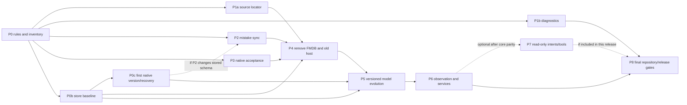

# Swift and SwiftData migration specification

Updated October 20, 2026. Status: specified for staged implementation; acceptance gates remain open. This is the execution specification for the remaining modernization. [TASKS.md](TASKS.md) tracks current status; historical validation receipts remain evidence for their stated source and scope. A plan item is complete only after its acceptance gate passes. Current source/dependency retirement is untested; actual product linkage and complete feature parity remain open.

## Current implementation order — October 20

The owner now requests **all production changes first, original-app usability comparison second, tests last**. That supersedes older tests-before-deletion sequencing below. Acceptance contracts, data preservation, exact writer assertion mappings and physical/signed gates remain required; source deletion is not acceptance. Old tests remain unmodified while production retirement proceeds and are not currently expected to compile. Do not run the legacy UI harness before its fixture launches/cleanup are ported: its retired flags must never fall through to a real production account.

Current untested changes include:

- One native SwiftUI root in every build; retiring the old DEBUG host, duplicate controllers, fifteen iOS storyboards, FMDB/old API clients, raw SQL diagnostics and generated wrappers. CocoaPods/SwiftGen integration is removed; native Swift packages now resolve strictly at committed revisions; the official pinned SwiftProtobuf build plugin replaces tracked generated Swift and the Makefile. Three preexisting owner-edited legacy files remain on disk, excluded from targets.
- Cold preference metadata/import separated from the deleted Settings UI. The remaining historical importer uses only read-only SQLite3 and generated Swift protobuf decoding. App/watch use Swift 6. Watch settings and complication rendering use SwiftUI/WidgetKit; the tiny settings host and installed-face migration adapter remain documented boundaries.
- Native review synonym/correction transactions, previous-subject navigation, keyboard controls, original-conjugation context highlighting, early completed-item summaries, continuing without forced reveal and exact-character feedback. Voice capture is injected through the app-owned environment.
- P2 prototype defects addressed with synchronous observed-event epochs, bounded lifecycle reconciliation and 24-hour wire projection; verified legacy binding/revocation persists in the existing Codable handoff payload without a model-field change. Production worker ownership is wired. Old-decoder/restart/concurrency tests and signed shared namespace remain open.
- Official Kanji Kentei 4/3/pre-2 subsets added to the bundled catalog/generator. Mainboard has a reusable per-file Swift source/import/platform/migration inventory. Neither addition has final suite evidence yet.

P0c production generation opening is **owner-approved and applied; G7 remains open**. The [implementation checkpoint](Implementation/2026-10-20-native-store-opening.md) records canonical Mac/iOS compilation, exact sources, historical proposal evidence and the source-reviewed fix for unordered handoff preference Sets. All ten model declarations retain their original identities/bodies. The opener compares stored physical model hashes before opening a verification clone, validates separate candidate values, durably selects that candidate and retains the actor's lifetime lease. Full handoff values use typed equality; ordered session/catalog arrays retain byte-sensitive order. No migration behavior was executed, no V2/model normalization exists, and historical nested Codable decoders are not independently frozen. WAL/physical-hash behavior, iOS file protection/fsync/interruption and external-writer limits remain open. Compilation and the older disposable naming experiment do not establish G7 acceptance.

The phase/status tables below describe the last accepted checkpoint. [TASKS](TASKS.md) and the [retirement manifest](Implementation/2026-10-20-native-retirement.json) own current implementation/deferred obligations. Debug app compilation now succeeds on Mac and iOS Simulator, including the watch dependency; no tests, app launches, UI comparison or live exercises have run for this production-change stage. The [integration checkpoint](Implementation/2026-10-20-native-integration.json) separates compiler evidence from behavior and retains watch warnings. Formatter and read-only source/configuration inspections are not feature acceptance.

## Watch UI and complication migration

Watch settings and all complication rendering now use SwiftUI. `WatchWidgets` supplies one WidgetKit `StaticConfiguration` with inline, circular, corner and rectangular layouts. The installed WatchKit extension embeds the widget, retains transport startup and keeps the tiny `WKHostingController` settings adapter. Its bundle identifier and private defaults domain are unchanged. The new widget is a child identifier under that extension; its group entitlement and runtime App Group setting match the writer's.

`LastKnownData` remains a private property-list dictionary; `DataSource` retains integer 0/1/2 and unknown values without rewriting them. A typed binary property-list mirror is written atomically into the configured App Group. No original cache is moved/deleted. Startup, source changes, accepted packets and the face migrator publish before WidgetCenter reload. The widget reads only the shared file; it does not activate WatchConnectivity or access account persistence. Publication failure preserves the previous shared file and reports failure; the migrator returns no configuration when publication fails. Signed group access is still an acceptance gate.

The nine phone packet keys/types and two-hour incoming cutoff remain unchanged. Complete typed packets are required; invalid/missing data never becomes a verified zero. No extra persisted timestamp-ordering rule blocks updates after clock correction. The current and pinned original producers supply independent hourly buckets: offset h projects `currentDue + sum(upcoming.prefix(h))` and `upcoming[h]`, bounded to 24 hours and checked for integer overflow. These are conditional schedule hints assuming no subsequent reviews. The timeline starts now, adds future whole-hour entries before expiry, then an unavailable entry exactly at `max(sent + two hours, nextReview)`. Empty/vacation schedules still expire. Native relative-date text appears only for a real future next-review date within the following 24 hours; VoiceOver uses the same date-aware content.

Connectivity background tasks are retained until session activation, pending-content drain and queued packet callbacks/publication attempts finish. Native pending-content observation and a callback DispatchGroup cover asynchronous delivery. Failed/nonactivated completion releases the retained tasks without claiming a successful widget update. Snapshot tasks retain their special completion behavior.

Following [Apple's migration guide](https://developer.apple.com/documentation/widgetkit/converting-a-clockkit-app), the original ClockKit principal class now only returns the real widget's static migration configuration. Its required old current-entry callback returns nil; template drawing and the old asset catalog are removed. WidgetKit supplies the timelines. Apple still invokes the migrator to transfer installed faces, so this small ClockKit reference is intentional. The separate [hosting bridge](https://developer.apple.com/documentation/technotes/tn3157-updating-your-watchos-project-for-swiftui-and-widgetkit) remains until single-target launch/container continuity is established.

Remaining gates:

1. Register/configure the owner-controlled App Group and matching signing profiles. Prove shared-file access and old private-cache continuity on a signed upgrade. The checked-in identifier alone establishes neither permission nor provisioning.
2. After production changes finish, compare the original installed-face information and watch settings usability. Verify all old advertised face families map as the OS supports; the four WidgetKit family implementations alone do not prove every old face upgrades correctly.
3. At the final test stage, cover raw selections, complete/malformed packets, clock correction, exact incoming/expiry boundaries, h=0/1/final, overflow, empty/vacation schedules, countdown/VoiceOver, atomic mirror failures, startup/migration-before-first-packet and background/KVO/callback/activation interleavings. Keep paired delivery, upgrades and accessibility as physical gates.
4. Convert the watch to the single-target SwiftUI lifecycle only with an established launch and private-container continuity path, then delete the empty hosting scene and old extension packaging.

The current [WidgetKit checkpoint](Implementation/2026-10-20-widgetkit.md) contains implementation/compiler evidence only. The previous [watch receipt](Implementation/2026-10-20-watch-swiftui.json) remains historical. No tests, launches, original-app usability comparison or signed upgrade acceptance are claimed.

## How to execute this specification

Read the [phase dependencies](#migration-and-deletion-sequence), [next checkpoints](#next-executable-checkpoints), [native recovery protocol](#native-store-recovery-before-a-migrating-open) and [test gates](#required-test-traceability) together. TASKS is the status ledger; this document owns the implementation contracts. Historical receipts establish only their recorded source and destinations. There is no schedule estimate until the current UI and production-upgrade blockers are measured.

The planning checkpoint `465dd79c` specified the work without accepting its prepared source. Implementation checkpoint `efc3cd5a249e4b9eff297410e0c1f9e3be18583b` now accepts the scoped avatar/Katakana, native UI-port, parser-enforcement and disposable upgrade-experiment evidence in the [current validation receipt](Validation/2026-10-20-native-practice-parser-and-upgrade-probe.json). It uses Mainboard `87461e5e` and root task commit `99cec4896`. No production schema, native generation selector or FMDB deletion is included.

| Evidence state | Meaning and permitted next action |
| --- | --- |
| Specified | Design and required assertions exist; implementation may begin after prerequisites |
| Prepared | Source exists, possibly with focused test evidence; it cannot permit caller deletion |
| Accepted for a stated scope | Source manifest, exact tests, destination and result are recorded; only that capability and scope may justify a deletion |
| Complete | All applicable requirements and platform/data gates pass, final callers/products are audited, and remaining exceptions are explained |

Eight original developer/practice/settings IDs now pass on the native phone/iPad scene; the two native Mac Katakana cases also pass. Eleven old-host source routes and the additional hosted notification invariant remain, with other Mac settings equivalents still to finish. The final Mac batch passes all six catalog/statistics cases plus both Katakana cases. Affected search/exclusion checks pass again on phone/iPad after the shared detail-header change. Retain the nineteen baseline obligations until their platform gates close. The dismissed repeating-popup report stays closed; Sources testing concerns an existing inline disclosure.

## Outcome and boundaries

Ship one shared SwiftUI application for iPhone, iPad and native Mac, using Swift 6 and SwiftData for durable app data. Preserve WaniKani grading, lesson order, review options, offline work, notes, exclusions, account identity and synchronization. Retain WaniKani colors, system typography and SF Symbols, with restrained native Liquid Glass. The original Tsurukame iPad lesson/review flow remains the interaction reference. Changing frameworks must not silently change study behavior.

The repository stays in `apps/usagiunagi`, with localized 兔鰻/usagiunagi identity. Work remains on the existing development branches, with commits and no PRs or pushes. Mainboard owns development dependencies, formatters, rules, builds, tests and receipts. App-specific task scripts must not grow into a second development system.

FMDB is to be removed from app source, target membership, dependency declarations and linked products. The old custom SQLite database still needs a read-only import path for supported existing installations. That boundary must use the system reader, be isolated from feature code, and never remain a second writer. SwiftData cannot interpret arbitrary legacy FMDB tables as a native model store. Its own [default store uses Core Data internally](https://developer.apple.com/documentation/swiftdata/defaultstore); the requirement is to eliminate our handwritten feature SQL and FMDB dependency.

Durable domain data belongs in SwiftData. Credentials stay in Keychain, ordinary preferences in AppStorage/UserDefaults, transient window input in SceneStorage, and downloaded media in files. These storage roles preserve platform behavior and avoid storing credentials or large media blobs in model records. WaniKani remains the authority for assignment/review progress. CloudKit must not independently replicate the answer outbox.

## Current implementation

The production scene uses `UsagiUnagiApp` → `StudyApplicationOwner` → `StudyAppAssembly` → shared `StudyRootView` on all three platforms. `StudyStore` is an `@ModelActor`, uses SwiftData transactions and returns Sendable values. Shared uses Swift 6.4 tools; app/watch use Swift 6. The main deployment floor is iOS/iPadOS/macOS 27. The watch retains watchOS 9 with SwiftUI settings and WidgetKit rendering. Signed shared-data/face migration, final single-target watch lifecycle and physical behavior remain open. The shared Japanese input adapter is a documented platform boundary.

The old DEBUG writer, controllers, raw SQL diagnostics, CocoaPods and SwiftGen integration have been retired. Normal iOS bootstrap retains only the read-only system SQLite3/protobuf historical importer and independent preference reader. The official pinned generator builds decoding types outside the source tree. Native diagnostics exports account-scoped SwiftData values. Recent-mistake lifecycle wiring and durable verified binding/revocation are implemented; old-decoder/restart/concurrency and signed shared-namespace acceptance remain open. Three owner-edited legacy files are preserved on disk with no target membership.

Historical acceptance: At `efc3cd5a249e4b9eff297410e0c1f9e3be18583b`, both Mac and iOS pass 523 shared functions in 72 suites: 239 Core, 196 Persistence, seven Speech and 81 UI/model functions. Both runs use the same 229-file Shared source/resource manifest `7230f443b48fbf1864aa5af6bb2d79832e361caa60ad3fd2ee7aafa3cc3edd48`. The final Mac UI batch passes 8/8 with one internal QoS warning. The iPad settings/practice batch passes 10/10; phone passes seven initially and the other three in a scoped retry after correcting ambiguous Back queries. All retain synthetic services and no real account exercises. The [current validation receipt](Validation/2026-10-20-native-practice-parser-and-upgrade-probe.json) records source ordering and exact scope. Earlier 479/491/508/513 counts remain historical. Physical IME/speech/audio, signed upgrades, notifications/background and watch gates remain open; free-level display references remain unsuitable as authenticated exercises.

## Evidence and decision baseline

The implementation baseline is app commit `fa3c3ddf265b9ce1acd78ef74a0d59eb2f20ccc8` and Mainboard `5796a2e2b3b39e86642591eb4f8ca4e9dff36561`. Counts below describe that committed source, not a promised final shape. P1a subsequently isolates the source locator and removes FMDB from importer fixtures; [its receipt](Validation/2026-10-20-legacy-importer-without-fmdb.json) records nine hosted importer and 24 shared bootstrap functions passing. Later phases remain open; this evidence does not authorize a data reset or establish full FMDB removal. P0b now freezes the exact committed native writer in a synthetic 218,485-byte fixture; pinned/current separate-process readers restore all 38 records across ten model types and two accounts. [Its receipt](Validation/2026-10-20-native-store-baseline.json) scopes this to macOS baseline/reopen evidence, with future versioned/iOS upgrades still open.

Source inspection found ten native model types and fifteen `.codable` attributes. In particular, `AccountRecord` contains the progress/statistics collections, `AssignmentRecord` wraps an assignment, and `SnapshotRecord` is keyed by a credential fingerprint. These are the starting points for modeling work, not a reason to create a second database abstraction. Reuse the existing `StudyStore` actor and four shared modules.

Apple documentation was checked on October 20, 2026, against the installed Xcode 27 SDK. The Mac SwiftData interface also declares ResultsObserver, HistoryObserver and the codable attribute option. API existence is verified; integration behavior still needs the tests below. Third-party articles about “2027” are not API contracts.

| Capability | Verified availability or limitation | Decision for this app |
| --- | --- | --- |
| Custom Codable attributes | Apple introduces `.codable` for types that cannot otherwise be modeled; encoded contents cannot be queried/sorted and payload changes do not trigger schema migration | Treat current app-owned blobs as migration debt. Prefer supported value types or models for owned data; reserve opaque encodings for justified immutable envelopes/external types. [Apple session](https://developer.apple.com/videos/play/wwdc2026/274/) |
| ModelActor | Available since iOS 17/macOS 14; serializes access to its model context | Keep the existing owner. Recheck account/revision after every suspension; actor isolation does not replace transaction or request-order guarantees. [ModelActor](https://developer.apple.com/documentation/swiftdata/modelactor) |
| Observation | ResultsObserver and HistoryObserver require the 27 releases; their roles are query results and persistent-history changes respectively | Prototype against one real projection before replacing existing listeners. Never equate a history event with server acceptance. [ResultsObserver](https://developer.apple.com/documentation/swiftdata/resultsobserver), [HistoryObserver](https://developer.apple.com/documentation/swiftdata/historyobserver) |
| Schema evolution | VersionedSchema and SchemaMigrationPlan describe explicit model versions and migration stages | Freeze the current store fixture before any model declaration changes; verify an actual upgrade, including the current unversioned store. [VersionedSchema](https://developer.apple.com/documentation/swiftdata/versionedschema), [SchemaMigrationPlan](https://developer.apple.com/documentation/swiftdata/schemamigrationplan) |
| AI and system actions | Foundation Models calls an app-defined Tool; AppIntent exposes an app-defined action | Add explicit bounded read adapters later. Do not assume SwiftData exposes the schema automatically or let generated output grade answers. [Tool](https://developer.apple.com/documentation/foundationmodels/tool), [AppIntent](https://developer.apple.com/documentation/appintents/appintent) |

## Historical accepted checkpoints and validation

Acceptance is scoped to source and destination on `codex/swiftui-27-curriculum`. P1a/P0b/P1b retain their earlier receipts; P2 remains an unwired tested prototype. The [current validation receipt](Validation/2026-10-20-native-practice-parser-and-upgrade-probe.json) adds the current platform, parser and test-only upgrade evidence. It supersedes the three Mac failures at `39f9ef9c` only for this new source. Production Swift lines grow from 32,049 at `465dd79c` to 32,221 (+172), excluding three unrelated owner edits and including formatter wrapping; no new runtime dependency or LOC savings is claimed. No push or hosted Actions pass is claimed.

| Phase | Status at this review | Next evidence required |
| --- | --- | --- |
| P0 | Fourteen-rule inventory and 130 earlier selected regressions at Mainboard `87461e5e`; separate parser verdict now covers all 313 first-party Swift inputs, with four focused scope regressions and invalid/valid fixtures; nineteen changed Swift files pass quality gates | Caller/resource/linkage audit, documented boundaries and SDK/date guidance provenance remain; findings are review signals and tooling publication requires authorization |
| P0b | Accepted at `8669eca8`: frozen native store, exact schema/values and Mac process reopen | G7 still needs a real versioned upgrade and iOS execution; never regenerate the fixture to make a migration pass |
| P0c | Production foundation not implemented. The macOS unchanged-schema naming/copy/save/reopen experiment now passes in the declared six-phase task and is wired into Actions | Freeze historical V1/decoders, implement generation resolution/capture/validation/selection, and prove the failure matrix on Mac/iOS before new stored fields/models; keep broad P5 normalization separate |
| P1a | Accepted at `ee25d32f`: importer locator and FMDB-free fixture writer | Retain G1/G2 as deletion regressions |
| P1b | Accepted at `01be7a38` for account-scoped typed diagnostics and Apple data transfer: five focused functions pass in the Mac/iOS shared suites; native sharing UI passes on Mac, iPad and iPhone | Preserve the receipt’s runtime/Release limits and the legacy SQL backup helper until its last old-host caller and tests retire |
| P2 | Seven-file prototype remains unwired; sixteen focused functions retain passing Mac/iOS evidence. The contract now distinguishes best-effort KVS from durable local history | Fix four prototype gaps, callback-time observed-event fencing, durable legacy binding/revocation and bidirectional compatibility; integrate native lifecycle and signed shared namespace without claiming atomic cloud convergence |
| P3 | Earlier four review/two negative and three native audio ports retain their scope. Final Mac catalog/practice batch passes 8/8; eight original developer/practice/settings ports pass on native phone/iPad; affected catalog follow-ups pass on both mobile destinations | Finish remaining Mac settings equivalents, eleven old-host routes and hosted notification invariant; preserve all nineteen baseline obligations/writer mappings. Prior material-editor frame warnings and physical gates remain open |
| P4–P8 | Planned; not accepted | Follow the dependency graph and the gates, with separate commits for deletion and schema evolution |

The current declared five-case details gates pass on both phone and iPad, but each structured result records four “Invalid frame dimension (negative or non-finite).” runtime warnings. The repeated message provides no usable source stack; neither an app calculation fault nor a framework defect is established. Keep this runtime gate open and record its source/result scope in the current receipt; no unqualified clean UI result is claimed. The earlier iPad diagnostic share-dismissal query failure is resolved by current sharing acceptance. Removing the extra center tap also restores the focused feedback/draft-preservation case on both iPhone and iPad. Earlier review receipts retain their exact scope; passing these cases does not authorize whole-host or dependency deletion.

The original catalog checkpoint preserves 60 typed examples and 237 text literals, six unlocked assignments, two locked subjects without assignments and excluded subject 3864. Its original phone/iPad 6/6 results and three Mac failures remain in the historical catalog receipt. The current final Mac result `test-59602a906f1740a488bf02d66b686e0e` passes all six catalog cases plus two Katakana cases. Phone `test-40c7fecbfc2f4b9f8fd287c759c46dad` and iPad `test-8479a6a9104c452a979b0daea1e5fc0d` each pass the two affected catalog/detail follow-ups with zero runtime warnings. Other whole-P3 obligations remain open.

## Requirements

| ID | Required result | Completion evidence |
| --- | --- | --- |
| M1 | One production SwiftUI feature implementation across iPhone, iPad and Mac | Shared screens and state, native builds and equivalent end-to-end flows; platform conditions confined to a documented capability boundary; G8–G11 |
| M2 | SwiftData owns durable application state and every normal write | Native schema/store APIs, account-isolated queries, atomic session/outbox transitions, no FMDB linkage or feature SQL; G3/G4/G11 |
| M3 | Existing work survives migration and restart | Real historical schema fixtures, current-native store upgrades, interrupted handoff/restart tests, immutable original source retained on failure; G1/G2/G7/G10 |
| M4 | Lesson/review behavior is preserved | Typed/Anki/voice, incorrect/correction/defer/wrap-up, draft pause/resume, lesson teaching/quiz and missed-subject results verified against existing policies; G3/G9/G10 |
| M5 | Cross-device and background behavior has one owner | Timestamp merge, notifications, background scheduling, links and watch transfer fed from committed native state, with logout/cancellation/account-change tests; G5/G8/G10 |
| M6 | Statistics remain understandable and credible | Shared plots, verified coverage lists, forecast/backtest validation and explicit separation of coverage from exam pass probability; G12 |
| M7 | Rules guide future cleanup without inventing semantics | Syntax-backed Swift checks, current-toolchain compilation, correctness lint, documented exceptions and official remediation links; no silent skipped source; G11 |
| M8 | Repository and CI stay small and reproducible | Dependency/task ownership in Mainboard, generated/vendor exclusions, deleted obsolete targets/resources, local passing receipts and authorized publication before hosted CI claims; G9/G11 and authorized hosted execution |

## Target architecture

Keep the existing four shared modules. Do not create parallel iOS/macOS feature folders or duplicate view models.

| Location | Responsibility |
| --- | --- |
| `App/UsagiUnagiApp.swift` and `App/Application` | App identity, one service graph, scene lifecycle, entitlements and platform composition |
| `Shared/Sources/StudyCore` | Sendable domain values, grading, kana/session policy, API contracts and deterministic statistics |
| `Shared/Sources/StudyPersistence` | SwiftData models, actor-owned queries/transactions, outbox/recovery, typed export and isolated read-only migration |
| `Shared/Sources/StudyUI` | Shared SwiftUI features and Observation state; narrow UI bridges live beside the feature that requires them |
| `Shared/Sources/StudySpeech` | Speech/recording lifecycle and typed transcripts; grading remains in StudyCore |
| `Resources` | Required assets, licensed reference catalogs and genuine offline fixtures; development generators use Mainboard |
| `Docs` | This specification, current task ledger, architecture decisions and scoped validation receipts |

Adapt layout to window size, content, accessibility and native presentation. Use compile-time platform checks for APIs that actually differ: microphone/audio session policy, WatchConnectivity, system settings, background refresh and window/menu configuration. A separate operating-system check must not create a second lesson/review implementation.

## Persistence contract

### Ownership and transactions

Use one model-container/actor owner for a store. ModelContext and live model objects do not escape that executor. UI, intents and future model tools receive immutable Sendable values or stable identifiers. Network requests and account verification run outside save transactions. Recheck account identity, generation and expected revision after suspension before committing.

A graded answer and the corresponding session advance/outbox record must commit together. A crash may leave the prior question or a fully committed new state; it must not lose an answer or duplicate an upload. Mark an attempt durably before sending. A timeout or uncertain server result stays pending for explicit reconciliation; it is never automatically replayed just because the process restarted. A successful WaniKani response and local acknowledgement remove work only for the matching revision. Material conflicts retain the local note and original revision until the person chooses a resolution.

Logout, token replacement, account switching and vacation must cancel or invalidate the relevant work, preserve unresolved data for the correct account and prevent an old task publishing into the new account. Multiple windows share the same store owner and cannot create competing writers.

### Schema and Codable values

Create a named VersionedSchema and SchemaMigrationPlan before the next stored-schema change. Preserve identifiers and outbox semantics during migration. Test opening a store written by the current committed app; an empty new store is insufficient evidence.

| Data | Model/query requirement |
| --- | --- |
| Account/profile | Stable verified account identity; token fingerprint where needed, never the token; account-scoped preferences/state |
| Catalog | Subject identity, level and searchable/groupable fields as model attributes; exact typed subject content retained |
| Assignments/progress | Queryable account, subject, due date and SRS state where measured hot paths need them; recent mistakes retain timestamps without inventing review events |
| Active session | Selected items, policy/options and revision preserved; transient text remains scoped to the matching window/session/question |
| Review/material outbox | Original payload, identity, revision, attempt marker and recovery/conflict information preserved atomically |
| Import receipt | Source identity/digest, verified destination and completed handoff phases retained durably |
| Statistics | Deterministic projections of saved verified progress; no independent authoritative progress copy |

The store already uses `@Attribute(.codable)` extensively for app-owned types. Apple recommends supported value types or models for owned data rather than using this escape hatch by default. P5 must audit all fifteen attributes, record each replacement or explicit retention reason, and remove serialization wrappers where SwiftData can represent the value directly. Keep immutable historical request/recovery envelopes exact while converting them; do not reconstruct them from a newer catalog. Codable payload shape changes require compatible decoding and are not automatically handled as model-schema migrations. Query and index only fields with an actual use; avoid turning every nested detail into an independently owned record.

The property inventory below fixes the scope of that audit. These are proposed dispositions, not final schema declarations or permission to flatten every value. A retained envelope needs an explicit compatibility/ownership reason; a typed candidate needs measured query or modeling value. Every changed representation must open the frozen current store and preserve its exact domain values in G7, then pass the additional behavioral gates listed. Shape changes inside a retained Codable value also require old-payload decoding/reopen tests even when the SwiftData schema checksum is unchanged.

| Current encoded property | Proposed disposition to prove | Property-specific acceptance |
| --- | --- | --- |
| `SnapshotRecord.snapshot: StudySnapshot` | Rebuildable display projection/cache candidate; retain the compatibility reader until account-backed reconstruction is proved | Preserve verified account binding through token rotation, `requiresAssignmentRefresh`, sample exclusion, pending counts and all display/coverage inputs; no new authoritative progress copy. G4/G7/G12 |
| `SessionRecord.session: StudySession` | Compatibility-first active-session envelope; this value is mutable, not an immutable historical request. Split fields only for a demonstrated need | Preserve queue/item order, both answer sides/errors, options, wrap/defer state, private random/question/decision state and revision so the next decision remains equivalent after reopen; commit session/outbox together. G3/G7/G9 |
| `ReviewRecord.submission: StudyReviewSubmission` | Retain as an exact historical request-envelope candidate | Same item/subject/assignment identity, timestamps, answer/error counts and request values; no reconstruction from current catalog or inference of delivery. G3/G7 |
| `ReviewRecord.originalItem: StudySessionItem` | Retain as an exact historical grading/recovery-envelope candidate | Preserve captured subject/grading input and per-side attempts; recovery/summary must not substitute newer catalog meanings or readings. G3/G7/G9 |
| `ReviewRecord.originalAssignment: CatalogAssignment?` | Retain as an exact optional historical assignment-envelope candidate | Preserve nil versus a captured assignment, original server identity/stage/dates and its association with the pending revision; no invented acknowledgement. G3/G4/G7 |
| `ReviewRecord.issue: StudyUploadIssue?` | Review supported typed issue/status fields only if they simplify actual queries; retain historical evidence exactly | Preserve nil, reason, optional HTTP status/server assignment and detection time; uncertain/rejected/changed/missing states retain their retry/reconciliation behavior. G3/G7 |
| `MaterialRecord.material: StudyMaterial` | Typed current-note/synonym candidate, separate from its captured attempt | Exact notes, Unicode, synonym values/order and exclusion marker; retain concealed fields, revision comparisons and changed-back edits. G3/G4/G7/G9 |
| `MaterialRecord.issue: StudyUploadIssue?` | Review typed issue/status fields under the same evidence-preservation condition | Preserve the complete issue and the difference between rejected and uncertain work; editing cannot accidentally make an uncertain attempt automatically retryable. G3/G4/G7 |
| `MaterialRecord.attemptedMaterial: StudyMaterial?` | Retain as an exact optional historical request-envelope candidate | Preserve the sent payload independently of newer local edits and keep its `attemptedRevision`; late/repeated acknowledgement cannot remove the newer draft. G3/G4/G7 |
| `MaterialRecord.recoveryBaseline: StudyMaterialBaseline?` | Retain as an exact recovery-envelope candidate; a typed representation must keep its three states | Preserve not checked, checked-and-missing, and checked-with-an-exact-remote-value, including server identity and notes. These states must not collapse to a single nil. G4/G7 |
| `ImportReceipt.handoff: StudyLegacyHandoff?` | Typed durable phase/account/source-binding candidate; keep the exact private preference snapshot where needed | Preserve source/account/credential-fingerprint binding, activation, media-layout interpretation and absent preference values; neither token rotation nor a default decoder may grant new ownership/activation. G2/G7 |
| `CatalogRecord.subject: CatalogSubject` | Supported typed subject content plus measured searchable/groupable fields | Lossless meanings/auxiliary roles, readings/restrictions, mnemonics, context, components, media and hidden/access metadata; keep existing scalar projections consistent and compare actual grading/queue/coverage results. G1/G4/G7/G12 |
| `AssignmentRecord.assignment: CatalogAssignment` | Typed queryable assignment candidate | Same account/subject/server identity, due/stage/hidden/availability fields and local revision; exact due ordering, replacement IDs, stale responses and pending-work protection. G3/G4/G7 |
| `AccountRecord.state: StudyAccountState` | Typed profile/cursors and measured per-subject progress/statistics ownership candidates | Preserve every profile/progress/level/statistic/voice/audio/cursor field, optional SRS definitions, refresh marker and superseded assignments; no empty/default reset or duplicate authority. G2/G4/G5/G7/G12 |
| `ArchivedReviewRecord.answer: ArchivedStudyReview` | Retain as an immutable local-resolution/recovery-envelope candidate | Exact archive ID/account, saved answer, captured subject/progress/assignments and observation/archive dates. It must never reenter the outbox or count as confirmed server history. G3/G4/G7/G12 |

### Frozen schemas and persisted payloads

The first named version must preserve the actual persistent entity identities, attribute metadata, uniqueness and default/optional semantics of the frozen unversioned writer. Freeze historical model declarations and the payload decoders they use before introducing a second version. A historical schema must not continue to reference mutable current model classes. Moving a model into a nested schema type, adding an alias or renaming a module is a compatibility change to prove, not assumed ceremony. Keep the original identity until the pinned fixture demonstrates an equivalent open. Apple's [VersionedSchema](https://developer.apple.com/documentation/swiftdata/versionedschema) and [SchemaMigrationPlan](https://developer.apple.com/documentation/swiftdata/schemamigrationplan) provide the version/stage structure; they do not establish compatibility with our existing bytes.

Each changed Codable envelope is a persisted-format change even when the model checksum stays the same. Freeze bytes from every supported producer, and explicitly specify missing keys, absent versus nil, unknown enum cases/versions, numeric bounds, Unicode/order and malformed/truncated data. Synthesized decoding and a property initializer are not compatibility proof. A new decoder may default genuinely optional display metadata; it must never default verified identity, handoff activation, server acknowledgement, an attempt marker or retry eligibility into existence. Keep an unsupported payload intact and return a recoverable failure.

New binaries must read the declared supported old payloads. Downgrading to an older binary after new-format writes is unsupported unless bidirectional compatibility is explicitly tested. Keep that boundary separate from rollback before activation; never advertise an old app build as data recovery. A P2 change limited to existing Codable records still needs these decoder/restart tests before production, even if it needs no new SwiftData property. Unknown legacy binding stays unverified and cannot gain ownership merely by decoding a new default.

For each of the fifteen properties, complete the existing inventory row with: actual query/caller, current identity, chosen supported representation, frozen source decoder, migration/backfill step, exact field comparison, affected behavior gates and measured cost. Keep one authoritative live representation. Any temporary coexistence belongs to a bounded migration stage; normal refresh/send code must not dual-write old and new representations. Historical request/recovery values are copied exactly, never rebuilt through ordinary save methods that create new revisions.

P5 starts with one measured query improvement and its smallest schema delta. Only after that passes should it separate growing progress/statistics ownership, convert other justified owned values and remove obsolete projections. Use additive/backfill/removal stages when a direct transformation cannot preserve values. Keep a frozen historical declaration/decoder as long as a supported direct-to-latest upgrade needs it. Account-scoped diagnostics are unsuitable conversion inputs because they intentionally omit global/unbound records and private bootstrap data.

### Model evolution and operation contracts

This is the proposed logical model; exact Swift declarations must be proved by the migration prototype. Preserve existing entity identities until an old-store upgrade passes. Do not rename entity classes and reshape their payloads in the same first migration.

| Current owner | Target representation and invariants |
| --- | --- |
| SnapshotRecord | Rebuildable display projection associated with a verified account. Account identity must not depend solely on the current token fingerprint; token rotation cannot orphan work. No raw credential is stored. Retain its compatibility reader until old stores reopen correctly. |
| AccountRecord | Stable unique account ID and typed profile/cursors. Move per-subject progress and growing statistics collections out of the whole-account opaque payload in measured steps. Keep one authoritative copy and rebuild display snapshots after conversion. |
| CatalogRecord | Account/subject composite identity; explicit searchable/groupable fields, with supported typed subject details. Preserve accepted/auxiliary answers, readings, restrictions, mnemonics, context, components, media and hidden/access metadata losslessly. A count-only catalog comparison is insufficient. |
| AssignmentRecord | Account/subject identity and local revision; native due date, stage, hidden/availability and server identity fields for queue queries. Compare exact queue membership/order before replacing the current projection. |
| Proposed progress/statistics records | Stable account/subject or server-record identity; native mistake timestamp, original local-time source where ambiguous, SRS state and answer/streak counters. Retain recorded resets, duplicate-history handling and missing-value distinctions. |
| SessionRecord | One saved active session per account with its revision. Preserve selected order, both answer sides, first-wrong flags, retry/defer/wrap state and options; never rebuild an interrupted queue from new settings. |
| ReviewRecord | Account/subject uniqueness, exact original item/assignment/submission, local revision, attempt marker and issue. Optional original assignment stays optional; migration cannot invent evidence of delivery. |
| MaterialRecord | Account/subject uniqueness, server ID, exact notes/synonyms, revision, pending state, attempted revision/payload and recovery baseline. “Not checked” and “checked and missing” remain different values. |
| ImportReceipt | Exact source identity/digest, verified account binding, handoff phase and compatible preference snapshot. Global native-writer selection and unbound import receipts are not casually reassigned to an account. |
| UploadPauseRecord / ArchivedReviewRecord | Durable retry deadline and exact local resolution archive. Archiving is not a server acknowledgement and cannot make stale assignments reviewable. |

Enforce identities with native uniqueness declarations and actor validation. Explicitly choose delete rules for any introduced relationships. Refresh may replace clean server data; it cannot cascade-delete dirty notes, saved sessions, pending/attempted work or recovery evidence. Account logout follows the existing explicit preservation/removal policy, not an implicit relationship cascade.

| Operation | Required atomic boundary and suspension checks |
| --- | --- |
| Commit an answer | Validate account and expected session revision; save the graded session, new outbox item and local mistake information together. No network request occurs inside the transaction. |
| Send pending work | Capture exact revision/payload; durably mark the attempt before the request. On return, recheck generation/account and acknowledge only that revision. A newer edit survives. |
| Apply a download | Verify account, endpoint and captured generation; reconcile against revisions captured before the request. An older response cannot restore an acknowledged assignment or overwrite a newer/changed-back note. Commit resource rows and cursors together. |
| Edit materials | Compare expected revision, including explicit absence. Preserve concealed fields. A conflict returns a typed error/comparison and keeps the editor draft; only an explicit replacement choice can overwrite the current value. |
| Switch account / disconnect | Cancel and drain owned work before changing credentials. Invalidate late results and observation tasks. No old account's state may be published or sent under the new credential. |
| Export / observe | Read committed values on the owning actor. Export performs no save/acknowledgement; observers have explicit lifetime and account cancellation. |

First freeze a disposable on-disk fixture from the committed native writer, with all ten record types and both accounts populated. Record its writer revision, schema metadata and expected domain values. Prove that the first named schema accepts that actual unversioned store before changing fields; assigning a version number alone is not upgrade evidence. Then change one group at a time: query fields/indices, progress/statistics ownership, supported values, and any cache cleanup. Decode old payloads before removing their declarations. Test each supported version directly to latest and repeat opening the migrated result.

If a compatible in-place stage cannot be established, stop that phase and specify a separate SwiftData-to-SwiftData conversion into a different store, with source retention and the same recoverable writer handoff. Do not silently substitute this path or erase the failing store. A model-open error must never invoke delete-and-recreate recovery.

### Native-store recovery before a migrating open

P0b freezes a test baseline; it is not a backup of an installed person's current native store. Before the first production open that may migrate that store, establish the minimal G7 foundation (P0c): a verified first named schema, a consistent retained source generation and a recoverable activation policy. This can precede P2 when that phase requires new stored fields/models; it does not bring the broad P5 normalization work forward.

**Placement and ownership.** `StudyApplicationOwner.production()` currently calls `StudyStore.open` on a fixed URL before constructing `StudyLegacyBootstrap`. Resolve the existing selection and capture the source in this application owner before the fixed original URL can open under a changed model. Open and validate the candidate, publish its selection, then expose that same actor to services. Ordinary launches open the already selected generation. The legacy bootstrap already needs an open store and cannot resolve its URL itself. Reuse one preparation task for windows and background launches. Do not construct account, upload, cloud, notification or companion workers until a selected store has passed validation. Confirm no extension or second process can write it during capture; if writers cannot be excluded, stop the upgrade.

**Storage decision.** Keep complete generations under the existing persistent Application Support directory, on the same volume, outside purgeable caches and temporary directories. Use one small versioned binary-property-list selection record outside the model store, containing relative generation identifiers, schema/format identity and the preparation/selection state. It must contain no credentials and accept no arbitrary absolute paths, traversal or symbolic-link destinations. This is bootstrap control metadata: reading a selector from the store whose URL it must select would create a circular dependency. Durable study records remain in SwiftData; add no second application database or general persistence framework.

A fresh install is established only after checking the fixed original native path, selection metadata and incomplete generations. A missing selector beside an existing unversioned store means an adoption/upgrade input. A missing selector beside unexplained generation directories, an invalid selector or a missing selected generation means recoverable failure. None may silently create an empty store. An existing legacy-install handoff remains a separate G1/G2 responsibility after native generation selection.

**Capture decision.** Stop new study/background/companion work and quiesce every owner of the source before capture or migration. Verify a supported mechanism for this selected SwiftData/DefaultStore version that preserves one coherent store generation, including journals/sidecars and support/external-data files. Capture into a retained generation; hash/enumerate its complete components and verify it reopens with the prior schema and the exact actual account set/values through a disposable verification clone. Production must preserve empty, single-account and multiple-account stores; acceptance fixtures additionally require two populated accounts. Never open the pristine retained generation for validation or maintenance. Make a separate disposable staging clone for any supported store-copy operation that can maintain auxiliary files, then produce a distinct candidate. Only staging may receive those incidental changes. An ordinary live main-file copy is insufficient.

The test-only Mac experiment uses the public [Core Data store replacement API](https://developer.apple.com/documentation/coredata/nspersistentstorecoordinator/replacepersistentstore(at:destinationoptions:withpersistentstorefrom:sourceoptions:type:)) on disposable clones of SwiftData's [DefaultStore](https://developer.apple.com/documentation/swiftdata/defaultstore). Its read-only option does not mean the source directory stays byte-for-byte untouched: writable clones can gain or change SHM/empty WAL files, while a fully protected journal-free source refuses with SQLite error 8. Do not run that operation directly against the retained pristine generation. This experiment establishes no production capture, atomic cutover or universal SwiftData backup facility.

Do not assume a public SwiftData backup/close API exists or reach into private Core Data objects. The current experiment rejects subdirectories and symbolic links and has no `.externalStorage` coverage. Introducing external storage or another store support-directory layout is blocked until complete capture, migration, protection and reopen tests cover it. Do not substitute record-level DataStoreSnapshot for a whole private-store backup. If coherent capture cannot be proved, stop production schema evolution and retain the working store.

**Validation and activation.** The retained source generation stays untouched while an upgrade candidate is validated. Compare the entire private store: all accounts, ten current model categories, optional/historical values, exact queue/session state, revisions, attempt markers, conflicts, archives, retry deadlines and global/unbound receipts. Domain comparisons need deterministic ordering without changing user-authored order. Counts alone are insufficient. Activation follows successful migration and exact value/revision/outbox comparison. Do not publish a generation by swapping its store and sidecars independently. Publish one selection record only after its complete candidate is ready, then bind the sole production container to that generation.

A fresh-process reopen is required acceptance evidence on Mac and iOS; it is not a requirement to launch a helper process inside the shipping iOS app. The existing Mac probe's `Process` mechanism cannot become the runtime design. Prefer validating the candidate through the same actor/container that becomes the selected production owner, publishing the selector and then composing services around that owner. This avoids a second writer and does not need a close/reopen API. Validation clones never become feature services. Prove those lifetimes through public APIs. If the chosen copy/migration mechanism still requires an unprovable release boundary, use an explicit validated/prepared state and finish activation on the next launch before workers start. Resolve and test that fallback in P0c before adoption; do not invent a public close call or claim deinitialization guarantees from a successful test run.

Atomic visibility of the selector and power-loss durability of every candidate component are separate claims. Choose and test publication ordering, validation receipt and filesystem guarantees on supported devices before calling selection durable. A partial candidate or malformed selector produces recovery UI with a bounded retry, never an in-memory fallback or empty success. Preparation may be retried only against the same verified source/schema identity.

| Durable state / interruption | Permitted restart behavior |
| --- | --- |
| No native files or selection, after complete discovery | Create a fresh generation once; proceed to the existing legacy/fresh-install bootstrap contract |
| Existing fixed unversioned store, no selector | Adopt it as the exact source; never open it first under a changed model |
| Source retained, staging/candidate incomplete | Keep the selected source; discard/rebuild only marked disposable artifacts, never source data |
| Candidate migrated but not validated | Validate the complete candidate or stop; it cannot receive normal study writes |
| Candidate validated, selection not published | Select only after source identity and the validation receipt still match; incomplete publication cannot infer success |
| Successor selected, workers not started | Open that successor and restore exact account/outbox state. Resume G1/G2 idempotently from preserved receipts without recreating consumed work; activated handoffs do not reread retired sources. Never choose the predecessor |
| First new answer or material edit committed | Restart must retain that successor and new revisions; the retained predecessor is not an automatic fallback |
| Selected generation missing/corrupt, or selection metadata invalid | Preserve all artifacts and surface recoverable failure; neither directory enumeration nor modification time chooses a different writer |

Do not delete predecessor generations in the first cutover checkpoint. A later explicit retention policy must prove a successful successor reopen and account for unresolved work, free-space limits and the last recoverable copy. Do not create a full backup on every ordinary launch. A disk-space failure must preserve the current selection; cleanup cannot erase the only recoverable generation to make an upgrade fit.

**G7 failure matrix.** Extend the existing persistence probe and production bootstrap tests; do not create another driver. The scoped macOS experiment now passes unchanged-schema naming/copy/save/reopen, including committed WAL-only changes, in the declared six-phase Mainboard task. Actions includes its bounded primary command. Its schema still references current classes and has no migration stages, so it neither freezes historical V1 nor proves the first field change. Production capture/selection and the Mac/iOS matrix below remain unimplemented.

| Case | Required result before P0c/P5 acceptance |
| --- | --- |
| Frozen unversioned producer → named unchanged schema | Exact metadata/domain equality, writable save and independent reopen on Mac and iOS; original bytes unchanged |
| First actual field/model change and every introduced version → latest | All supported routes, repeat open, complete data equality and compatible historical decoding; empty-store success is insufficient |
| Main-file, committed WAL and support components | Coherent capture; retained hashes unchanged by staging operations; WAL-only commits survive |
| Interrupt before/during coherent capture, the first migrating open, validation and activation, then reopen in a fresh process | Exactly one selected writer and complete prior or successor state, no partial generation or lost answer |
| Permission/disk-space failure, unsupported/corrupt payloads, incomplete candidate or selector | Keep selected/source data; no empty replacement, false completion or automatic destructive repair |
| First post-activation answer and material edit, then interruption | Exact new payloads/revisions survive without downgrade to the retained native generation |
| Two accounts, token rotation, logout and production worker startup | No stale-account publication, changed receipt ownership or automatic replay of attempted/uncertain work; only matching acknowledgements clear revisions |
| Prepared/unactivated legacy handoff or credential-saved/activation-missing state inside an upgraded native store | Resume the exact preserved G1/G2 phase and binding; no inferred activation, duplicate pending import or return to a retired writer |
| External-data files, file protection and native iOS lifecycle | Explicit new coverage before those representations ship; no inference from the current journal-free Mac fixture |

These production-path tests are separate from the accepted read-only `applyDownload` transaction-rollback test; neither proves the other. The source stays recoverable on error. Retrying an upgrade cannot downgrade schema, discard native activity or replay an uncertain server request.

### Observation

Replace custom event plumbing with ResultsObserver only after a prototype proves equivalent behavior. Keep observation on the owning actor and convert results to Sendable projections there. Check local writes, second-context commits, rollback, deletion, cancellation, logout, account changes and reopening. A rollback must not announce a committed state. Observers must not retain dead windows or publish an old account’s data.

Evaluate HistoryObserver for actual external/context writers and restart catch-up. Persist history tokens where needed, filter authors, process each transaction idempotently and test replay after a crash. A history notification wakes reconciliation; it is not proof that WaniKani accepted an answer. Avoid adding both observers and the old listeners indefinitely: delete the replaced path once parity is proven.

Apple documents [ResultsObserver](https://developer.apple.com/documentation/swiftdata/resultsobserver) and [HistoryObserver](https://developer.apple.com/documentation/swiftdata/historyobserver) in the 27 releases. [ModelActor](https://developer.apple.com/documentation/swiftdata/modelactor) already existed in earlier systems and does not make logical races across suspension impossible. The [official SwiftData session](https://developer.apple.com/videos/play/wwdc2026/274/) covers Codable limits, sectioned queries and observation.

## Migration and deletion sequence

Each phase is a reviewable checkpoint. Commit after its gate passes; no phase claims completion from a build alone. Preserve unrelated owner edits. Do not combine broad deletion, a schema rewrite and UI redesign into the same checkpoint.

| Phase | Change | Required gate before proceeding |
| --- | --- | --- |
| P0 Rules and inventory | Finish current-toolchain Swift parsing, correctness/formatting checks, migration signals, official guidance and an exact caller/dependency inventory | Real app scan covers all selected source; positive/negative rule tests; no source skipped silently; required CI commands work standalone |
| P0b Freeze native-store baseline | Capture the exact current unversioned schema, populated store and domain expectations before model edits | Fixture opens with the committed writer; all ten record types, account boundaries, uncertain work and revisions are represented; native schema evolution cannot start without it |
| P0c Minimal native evolution foundation | Before any stored-schema mutation, prove the first named schema/plan and coherent native source-generation recovery; run before P2 only if its durable binding needs new stored fields/models | G7 opens the actual unversioned store, preserves exact values and proves interruption/failure/restart and activation of a single coherent generation; no broad model normalization or old-writer deletion |
| P1a Isolate legacy source location | Extract the database URL locator from LocalCachingClient; document the remaining import-only boundary | Clean install and old-install bootstrap/reopen preserve exact source discovery without constructing the old writer |
| P1b Native typed diagnostics | Replace native diagnostic sharing with a consistent SwiftData export; retain recovery responsibilities and retire old-host export with its final caller | Complete export without credentials during concurrent saves; cancellation/failure leaves the store intact. This is required for removing feature SQL, not technically for removing FMDB |
| P2 Native recent mistakes | Move cross-device timestamp merge and lifecycle ownership to native services | Fake cloud store tests for account isolation, latest timestamp, 24-hour window, malformed archives, startup catch-up, logout, simultaneous local/cloud changes and no feedback loop; native practice counts update without review uploads |
| P3 Retire legacy acceptance and UI owners | Port remaining feedback/milestone, details/conflict, login/account, Home/catalog, practice/voice, settings/audio and refresh cases to the production scene | Equivalent behavior cases on native Mac/iPhone/iPad, with local synthetic services; production routes never construct the legacy host |
| P4 Delete FMDB and old writer | Remove LocalCachingClient, PendingUploadStore, SyncStore, old TKMServices/controller callers, FMDB helpers and obsolete generated storyboard accessors/resources once their final callers are gone | Zero app-owned FMDB import/reference/dependency/linked product; current-native reopen/historical-source import and crash/restart gates pass; all required builds/tests pass |
| P5 Evolve native schema and queries | Use the proven versioning/recovery foundation for measured query fields/indices, supported values and sectioned projections | Before/after queue/count/chart equality, each introduced-version upgrade, full-catalog performance comparison, rollback/recovery, no duplicate durable source of truth |
| P6 Simplify observation and services | Adopt native observers where they replace existing work; finish native watch/notification/background integration | No duplicate wake/upload loop, no stale-account publication; resolve current SDK scheduling deprecations without changing delivery semantics; automated lifecycle checks plus required physical delivery/expiration evidence |
| P7 Optional read-only intents and AI tools | Preserve existing Siri/activity behavior in P3/P6; after core parity, add bounded typed search/focus/coverage/forecast adapters if included in the release scope | No credential/raw ModelContext exposure; availability fallback, cancellation, bounded queries and no ability to grade/send/acknowledge answers. This phase is not a prerequisite for FMDB removal or the core migration release |
| P8 Repository and release gate | Remove unused files/dependencies/targets and finish Swift 6 mode for app-owned code; verify standalone Actions and distribution configuration | Clean checkout dependency restore, native Release builds, full automated gates, signed-upgrade/device acceptance; publish only after explicit push/distribution authorization |

P0b can follow P0 independently of the no-schema-change work. P1a and P1b may progress after P0, and P3 can progress alongside them. P2 must first choose its durable binding/revocation representation. If existing records can represent it, prove compatible old-payload decoding and fresh-process behavior without inventing a verified binding for old stores. If it requires new stored fields/models, P0c and the corresponding G7 stage must pass before P2 writes them; P2 must not wait for the broad P5 normalization. P4 requires P0b baseline/reopen proof plus P1a, P2 and P3 to pass; it cannot be replaced by marking old files DEBUG-only or renaming a wrapper around FMDB. P1b is independent of the FMDB dependency and remains necessary for M2’s removal of feature SQL. P5 requires P4 and the P0b/P0c foundation, and must preserve the source/import evidence still needed by supported installations. This separates the minimal version/recovery prerequisite from later modeling cleanup and avoids a P2 → P4 → P5 → P2 dependency cycle. Voice usability, statistics calibration and native watch work can run independently while these storage phases proceed.

### Next executable checkpoints

Keep the production path as `StudyRootView` → existing feature model/service → `StudyStore` actor. It owns native reads, atomic writes and durable recovery; verified WaniKani responses own server progress. The read-only SQLite3/protobuf importer remains a conversion boundary, and credentials, preferences and media retain their separate Apple-native storage roles. No temporary replacement writer or parallel platform app is needed.

| Checkpoint | Concrete deliverable | Acceptance and stop boundary |
| --- | --- | --- |
| Close the current catalog/statistics port | Accepted scoped final Mac six-case pass plus two Katakana flows; affected phone/iPad search/exclusion follow-ups pass | Retain original assertions, current source/result manifests, one Mac QoS warning and independent earlier material-editor frame-warning gate |
| Finish P3 feature parity | Eight original mobile ports accepted; native Mac Katakana accepted; finish other Mac settings equivalence and eleven old-host routes plus hosted notification invariant | Preserve nineteen baseline obligations and exact writer mappings, independent Home/counts oracle and injected native voice. No missing capability may be deleted |
| Prove minimal P0c before stored-schema changes | Bounded unchanged-schema experiment is integrated in the existing Mainboard/Actions checks; implement production capture/validation/selection and frozen V1/decoders next | Complete failure matrix on Mac/iOS and production startup with two synthetic accounts/outboxes. The macOS experiment proves no cutover or actual model transformation |
| Integrate P2's existing native prototype | One native history owner, durable legacy binding/revocation, observed-event epochs, bounded lifecycle retry and 24-hour best-effort wire merge | Preserve sixteen prototype tests, add compatibility/lifecycle/concurrency/restart cases and signed-namespace delivery. KVS has no CAS/remote acknowledgement; keep the old service until parity passes |
| Perform P4 deletion without changing schema | Remove old writer/host, final controllers/storyboards, FMDB declarations/lock integration/linked products and their obsolete helpers in one reviewable checkpoint | P0b/P1a/P2/P3 gates and nineteen exact writer mappings must pass; verify original-source import, current-native reopen, crash/restart, native destinations and actual dependency/products. Retain the read-only importer and necessary platform bridges |
| Start P5 as a separate modeling checkpoint | Build on the accepted P0c VersionedSchema/MigrationPlan and recovery foundation; make one justified model/query improvement at a time, auditing the fifteen opaque attributes | G7 must prove a populated frozen-store upgrade on Mac and iOS, exact values/revisions/attempts/conflicts, compatible envelope decoding, rollback and measured queue/count/chart/performance parity. Never replace a failed migration with a data reset or regenerated fixture |
| Close P6–P8 and release gates | Simplified measured observation/service code, completed physical capabilities, standalone CI and signed release configuration | Preserve feature/data gates after deletion/evolution; close IME/speech/audio/notifications/background/watch and signed-upgrade gaps, explain remaining warnings, verify authorized hosted CI before claiming it, and obtain explicit publication authorization |

A local UI pass, dependency removal and release readiness are different milestones. The current scope permits no schema redesign or FMDB deletion merely because the new review rules find the existing storage sites.

### FMDB caller and dependency removal

After accepted P1a, the current direct imports are four runtime adapters (`LocalCachingClient`, `PendingUploadStore`, `SyncStore`, `FMDatabase+Assert`) and two hosted-test files. No app-owned Objective-C implementation/header files remain tracked; Objective-C still arrives through installed dependencies. A source-extension count alone cannot establish a Swift-only built product.

| Caller or dependency | Replacement or removal condition |
| --- | --- |
| Original source locator | Accepted P1a: production uses `LegacyStudyImporter.databaseURL`; the old cache delegates only its compatibility accessor. Keep exact source discovery covered when deleting that accessor |
| DEBUG Screenshotter/AppDelegate/TKMServices/legacy coordinator | Move its remaining acceptance callers to injected production services before deleting the host and its controllers |
| `LegacyStudyImporterTest` | Accepted P1a replaces its FMDatabase writer with system SQLite3; retain all nine functions and their malformed/WAL/schema cases |
| `PendingUploadAcknowledgementTest` and `SyncStoreTest` | Map their four plus fifteen test functions to native outbox/synchronization invariants, verify the replacements, then delete the old writer-specific tests |
| Native diagnostics and `SQLiteDiagnosticArchive` | P1b supplies account-scoped typed diagnostics with passing Mac/iPad/iPhone sharing acceptance. The SQL helper remains only for the old-host `local-cache.db` boundary and retained tests; preserve recovery responsibilities and retire it only with its final caller |
| Podfile and Podfile.lock | Remove FMDB, restore locked integration and inspect the resolved dependency graph; avoid unrelated dependency updates |
| Project/framework integration | Remove stale FMDB build/link/embed references and verify each destination’s linked product; retain required remaining CocoaPods integration until its other callers retire |
| SQLite3/protobuf legacy reader | Preserve its supported source conversion independently of FMDB; it already has no FMDB import |

Whole-host retirement also covers non-writer test callers. The following are migration destinations to audit assertion by assertion, not claims that the shared suites already replace every assertion. Before deleting each old test/adapter, retain its unique behavior in Swift Testing where it is pure/shared, or in hosted/physical acceptance where it exercises a required native bridge. XCTest/XCUITest remain appropriate for UI automation; changing a test framework alone is not coverage.

| Current hosted test owner | Destination / behavior to preserve |
| --- | --- |
| `App/Tests/ReviewSessionTest.swift` | `StudySessionTests`, `NativeReviewTests` and `StudyStoreTests`: exactly-once durable completion, zero practice writes, incomplete catalog rejection, correction/reading credit, synonyms and edits during details |
| `App/AppTests/ReviewSessionOptionsTests.swift` | `ReviewPreferencesTests`, `StudySessionTests` and native quick-settings acceptance: option round trip, combined/reading Anki and frozen active-session behavior |
| `App/Tests/ReviewPreferencesAdapterTest.swift` | Keep legacy archive/key/raw-value semantics in `LegacyStudyPreferencesTests`; native merge/round-trip behavior in `ReviewPreferencesTests`. Preserve importer compatibility after deleting the old live adapter |
| `App/Tests/TKMKanaInputTest.swift` | `KanaConverterTests` plus the retained `StudyAnswerInput` bridge/physical gate: every mapping, selection/UTF-16 caret, deletion/paste, delegate-return semantics where still applicable and untouched marked text |
| `App/Tests/AnswerCheckerTest.swift` | `AnswerGraderTests` with the original corpus and subject/component context; explicitly retire protobuf conversion mechanics only after G1 preserves historical grading inputs |
| `App/Tests/StudyStatisticsTest.swift` | Native metrics/pace/curriculum suites and G12: empty/missing/hidden data, weighted accuracy, overdue schedule, focus, resets, duplicate levels and suppressed unsupported forecasts |
| `App/Tests/RecentMistakesTest.swift` | `StudyMistakeArchiveTests`, `StudyMistakeStoreTests` and `StudyMistakeSyncTests`, retaining old JSON/time parsing and new identity/convergence tests; P2 remains unaccepted |

FMDB removal does not by itself retire Reachability, SwiftGen, Hippolyte, SVGKit or their transitive dependencies. Audit each final caller separately, then remove the dependency and stale build resources at the same checkpoint. Keep source licenses and historical receipts.

### Native recent-mistake service (P2)

This phase moves ownership without changing study semantics. Recent mistakes are timestamps used to select Extra Study; merging them must not create an answer, change an assignment/SRS stage, revise a session or enqueue an upload. SwiftData local history remains authoritative. The original service is also a best-effort whole-key bridge; replacing it does not require inventing stronger cloud guarantees.

The existing wire key is `<username>tsurukame-mistakes`; its Data contains a JSON string dictionary of subject IDs to local `yyyy-MM-dd HH:mm:ss` strings. The old code also writes a global `lastSyncCall`. Preserve bidirectional compatibility with existing clients under a proven legacy binding. A native-key-only or one-time-import design would drop that behavior and needs an explicit scope decision before adoption. The old formatter leaves locale/calendar implicit. Preserve the original text and test non-Gregorian settings, time zones and DST ambiguity; an absolute native timestamp cannot recover missing legacy interpretation metadata.

Native wire contract: key `usagiunagi.mistakes.v1.<verifiedAccountID>` and a binary-property-list envelope with `formatVersion: 1`, matching `accountID`, and sorted entries of positive `subjectID: Int64` and nonnegative Unix-second `timestamp: Int64`. Reject missing/mismatched identity, duplicates, invalid values, unknown versions and unknown fields at every level without rewriting the source. Future producers must bump the format version when extending its shape. The unwired prototype's sixteen focused tests include strict unknown-field rejection on Mac and iOS; they do not establish production lifecycle or signed delivery acceptance.

A durable binding records the original username, explicit locale/calendar/time-zone interpretation, verified stable WaniKani account ID and exact activated source receipt/digest. Capture it only during a newly verified source handoff; old receipts cannot gain ownership by inference. A verified username change durably revokes that binding, including after restart or rename-back. Import, observe and compatibility-write the username key only under its matching unrevoked binding; fresh accounts cannot claim an arbitrary username archive. Keep old keys and unattributed data recoverable. The prototype injects a binding but does not persist its capture/revocation. Compatible changes to an existing Codable value still need frozen old-decoder/restart proof; new stored fields/models require P0c/G7 first.

Keep parsing/merge policy deterministic and shared, local application inside `StudyStore`, and NSUbiquitousKeyValueStore lifecycle in one app-owned injected adapter. Production explicitly injects the default store; synthetic fixtures never acquire it. Register the external-change listener before initial catch-up, coalesce committed local/external changes, wake on foreground and cancel/rebind on verified WaniKani identity changes. Strict stable account/envelope ownership remains mandatory regardless of cloud delivery limitations.

The adapter owns an observed-event epoch. Increment it inside the Apple-account notification callback before yielding to a worker; recheck it and the verified WaniKani account/key/generation after each await and immediately before starting a write. This fences a reported event still queued for consumption. It cannot detect an account switch before Apple reports it or retract an already accepted write; document those residual limits rather than claiming atomic Apple-account fencing. Account changes invalidate cloud tasks/buffers, never local WaniKani history. Apple's [account-change reason](https://developer.apple.com/documentation/foundation/nsubiquitouskeyvaluestoreaccountchange) describes replacement by the new account's cloud data.

Do not infer KVS availability from FileManager's [ubiquityIdentityToken](https://developer.apple.com/documentation/foundation/filemanager/ubiquityidentitytoken), which describes iCloud Drive Documents identity. Do not add Drive or CloudKit entitlements to manufacture such a status check. Apple's [initial-sync reason](https://developer.apple.com/documentation/foundation/nsubiquitouskeyvaluestoreinitialsyncchange) means initial download is in progress, not a completion acknowledgement. Delay writes appropriately, use bounded retry and foreground reconciliation, and never leave the worker waiting permanently for a particular reason code. [synchronize()](https://developer.apple.com/documentation/foundation/nsubiquitouskeyvaluestore/synchronize()) is not a forced upload or remote acknowledgement; call it sparingly at lifecycle boundaries.

Merge the maximum timestamp per supported subject into existing known local progress only. Never fabricate a catalog, assignment or previously unknown progress record. Preserve unapplied in-window cloud hints for later reconciliation. Bound the wire projection to the original 24-hour window while retaining durable local history; do not age history out merely to trim cloud data. Test exact retention boundaries, DST, changed time zones, clock rollback and future timestamps without reinterpreting a future instant as a new mistake now. Practice eligibility still uses common `StudyAvailability` policy.

Whole-document malformed data is a recoverable error, never an empty successful read followed by overwrite. Define invalid individual-entry handling separately. Unknown versions, quota failures and unavailable delivery preserve both local practice and the recoverable cloud source. Write only when the canonical merged payload changed; no local changes means no store transaction. Self-writes must not cause an unbounded read/write/notification loop.

KVS has no compare-and-swap or atomic cross-device maximum merge. Rereading before a whole-key write cannot eliminate concurrent overwrites. Require idempotent maximum merging and eventual reconciliation when contributors with durable local history reconnect through foreground/local/external catch-up; do not promise lossless arbitrary overwrites, acknowledgement or unconditional convergence. Test disjoint and same-subject changes on disconnected devices, overwrites and later reconciliation. The original FMDB bridge provides no stronger delivery semantics. A stronger replicated history would be a separately scoped transport change, not a hidden prerequisite invented for this parity migration.

Test startup and missed notifications; initial/server/account/quota reasons; queued-event invalidation; logout during read/write; username rename/reuse and restart/revocation; two WaniKani accounts; simultaneous local answer/cloud changes; same-second ties; unknown IDs; bounded retry; missing entitlements and absent/unavailable cloud delivery. Keep local practice usable. Validate key/payload limits (1 MB total, 1024 keys and 128 UTF-16 units per key) against [Apple's KVS contract](https://developer.apple.com/documentation/foundation/nsubiquitouskeyvaluestore), without equating a local write/synchronize result with confirmed delivery.

The current source addresses the four prototype gaps: Documents-token inference is removed, callback-time epochs fence observed identity events, bounded lifecycle reconciliation replaces the initial-only wait, and publication uses a 24-hour projection. Durable verified binding/revocation and production ownership are wired. These changes have compilation evidence only; protocol/old-decoder/restart/concurrency behavior remains unaccepted. Retain the sixteen prototype regressions and add the compatibility/lifecycle cases above before removing the original service.

Signed delivery is a separate gate: iOS currently uses `$(TeamIdentifierPrefix)$(CFBundleIdentifier)` for its namespace; Mac's separate entitlements lack a ubiquity key and bundle identifiers differ. Define an owner-controlled shared namespace and inspect signed entitlements on both products. Do not assume this fork can access upstream Tsurukame's iCloud or Keychain identity, or test by writing to the person's real cloud account.

Integrate through the existing assembly/owner: start one worker after native restore, wake on foreground, stop on teardown and rebind on verified identity changes. Present errors inline without a repeating modal. Test coexistence with the automatic review sender and multiple windows, without a second writer or upload loop. P2/G5 and signed delivery remain open.

### Diagnostics and recovery copies (P1b)

P1b interface: `StudyStore.diagnosticDocument(accountID:)` returns one versioned Codable/Sendable projection; `StudyDiagnosticArchive(store:accountID:)` provides export-only Transferable conformance. The production native root composes it from the verified non-sample account and existing store. No database URL, second container, credential-store access, alternate writer or permanent duplicate snapshot is needed. Five focused functions pass in the Mac/iOS shared suites, and native sharing UI passes on Mac, iPad and iPhone; the current receipt records exact source/runtime/Release scope at `01be7a38`.

The actor must fetch the whole projection without suspension so it represents one committed state relative to the single app writer. Encode binary property-list Data off that actor; use Apple `DataRepresentation(exportedContentType: .binaryPropertyList)` with a unique suggested filename so the framework manages transfer publication and lifetime. Do not add an app temporary-file cache or a custom file-transfer wrapper. Profile large exports before choosing a more complex representation. Export must preserve:

| Content | Required detail |
| --- | --- |
| Account and display data | Profile, progress, statistics, cursors, SRS definitions, levels, voices/audio references, and selected account's cached projections; omit credential fingerprints |
| Catalog and assignments | Exact typed subject/assignment values and local assignment revisions |
| Saved session | Full queue, question/answer state, options and revision |
| Review outbox | Exact submission/original item/original assignment, revision, attempt marker and issue |
| Material outbox | Notes/synonyms, server ID, revision, pending/attempted payloads, issues and recovery baseline, including observed absence |
| Recovery and handoff | Archived reviews, retry deadline, source digest and verified account-bound handoff status; exclude credential IDs and private preference payloads |

Import receipts currently mix account-bound, unbound and global writer-selection records. Include only receipts with verified ownership. The format always declares unbound/global receipts out of scope; it must not inspect or count another account's records to report their presence. Do not parse ownership using a loose account-prefix match or export all receipts. If complete recovery requires these records, specify a separate private recovery format rather than weakening diagnostic account isolation.

Label the control “Export study diagnostics” and state that notes and pending work are included. Exclude app-managed API tokens, Keychain contents, credential fingerprints, other accounts, preferences, media bytes and app-private path metadata. User-authored notes remain exact as disclosed; this is not a universal secret/path-redaction format. Do not upload automatically. A document selected for one account cannot be replaced with another account's data while sharing. Cancellation/encoding failure must not yield partial Data or change durable study state; Apple handles the transfer destination and its errors. Each completed export is an immutable independent artifact. Repeating a later export may capture newer committed data for the same fixed account; it must never switch account identity.

A typed diagnostic document is not a restorable database backup. This change can replace diagnostic sharing only if that is the current feature contract; it cannot silently remove recovery/backup capability. Keep original source stores and the existing legacy WAL-safe backup path while its callers/tests remain. If user-restorable backup is required, its restoration must be a separate account-verified, versioned feature with no automatic replay of attempted work. Do not offer Import merely because Export exists.

### Original-data handoff and recovery

Source access has two distinct supported cases. A same-identity installation upgrade can discover its original file in its own container. A separately signed fork cannot assume access to upstream Tsurukame's sandbox, Keychain or cloud namespace. For that case, specify a user-selected exported source/document route and security-scoped access, with supported schema validation and the same account verification before import. No automatic cross-sandbox extraction is part of this plan. Confirm source availability/export capability before claiming original-app migration; if none exists, keep that distribution gate open and preserve the original app/data. Independent branding or a new bundle ID does not grant access to the old container.

1. Open the old source read-only, including committed WAL state, and identify its supported schema and account.
2. Capture immutable source bytes/metadata and validate grading inputs, pending work, notes and progress. Do not call Settings getters that mutate old defaults.
3. Verify the destination account using the existing read-only account capability. Do not place the API token in a receipt, fixture, export or log.
4. Import all related records and a source receipt in one native transaction. A repeated import must not recreate consumed pending work. Preserve the existing conservative rule: imported pending reviews are marked attempted and pending notes uncertain because the old queue cannot prove delivery. Import must not make them automatically uploadable.
5. Save/verify credentials and activate the native-writer choice through the existing recoverable handoff sequence. Resume from durable phase state after interruption.
6. Hydrate only absent native preferences; later native edits win. Keep compatible media directories where possible.
7. Reopen in another process, verify counts/revisions/payloads and exercise one synthetic offline review and material change.
8. Keep the original source on error. Unsupported or malformed data opens recovery UI and must not silently create an empty replacement account or restart the old writer after native activation.

Signed Keychain/upgrades remain a physical acceptance gate even when disposable fixture handoffs pass. Historical source schemas 9–15 and interrupted WAL/protobuf cases must remain supported by tests until an explicit supported-upgrade policy replaces them.

### Handoff state machine and failure policy

Keychain, SwiftData and preferences are separate persistence systems; there is no cross-system atomic transaction. The existing handoff deliberately uses durable phases. Keep this behavior explicit:

| Durable condition | Permitted next action | Restart/failure behavior |
| --- | --- | --- |
| No selection / no legacy credential | Select a fresh native writer durably | A later logout/reopen never discovers a stale legacy token and changes the writer choice |
| Unselected legacy installation | Read a consistent source, verify identity, reread and compare token/digest/preferences | Offline/invalid identity or source change preserves source and blocks activation; it cannot masquerade as a fresh install |
| Imported receipt, no bound handoff yet | Reverify identity and finish binding to the exact source digest | Idempotent import cannot recreate a consumed pending item; do not assume an unbound receipt authorizes credentials or a writer |
| Prepared/bound, not activated | Verify the same source/credential; save a missing matching credential, re-read it, then activate | Credential failure/conflict retains prepared data. Never overwrite a newer credential. A valid prepared binding can resume with its existing verified identity under the current protocol |
| Credential saved, activation missing | Recheck binding/snapshot and commit activation | The crash window is resumable; a saved token alone cannot choose a writer |
| Activated, preferences not hydrated | Restore only absent compatible preferences from the receipt | Retry without reading retired source/token/network; preserve subsequent native choices |
| Activated / subsequently logged out | Restore native services or native sign-in only | Never reopen the legacy writer or reimport its stale queue |
| Unsupported schema, corrupt store, source mismatch or inconsistent receipts | Show recoverable failure with a bounded explicit retry | Keep source and destination. Never reset, silently start empty, retry uploads or reopen old writer |

Inject interruption before/after every durable phase in disposable stores and reopen in a separate process. The existing probe already exposes import/save/activate/preference and fresh-selection phases; extend it for new states rather than building another app-local harness. Preserve committed WAL reads without checkpointing/truncating or replacing the source file. Keep original data on failure; source disposal is outside this migration until a retention policy is specified.

A code rollback is safe only before native activity, or to a build that understands the same native schema/outbox. Reinstalling an old writer after new answers have been saved risks two divergent queues. A gate failure stops the phase and preserves the working native version; it is not permission to downgrade data or copy the old database over the new one.

## UI parity and platform exceptions

The following are the remaining boundaries to inspect, not authorization to remove their behavior:

| Boundary | Why it currently exists | Condition for removal |
| --- | --- | --- |
| StudyAnswerInput’s iOS UITextField adapter | Japanese keyboard selection, marked text, caret and return handling; Mac uses SwiftUI TextField behind the same interface | A documented SwiftUI equivalent passes physical Japanese IME/caret tests and all typed/voice/pause flows |
| UIKit/AppKit settings and lifecycle calls | OS settings, app/background capabilities and native menus/windows differ | Replace with an equivalent supported API, retaining capability behavior and errors; keep a small adapter when needed |
| Read-only legacy SQLite3 importer | Existing files use a custom schema, not a SwiftData model store | All supported original installations have a supported conversion route; never remove it by deleting user data |
| WatchConnectivity/remaining companion code | Transport and OS callbacks are not presentation | Shared native source/transport tests and paired-device delivery pass; move presentation to SwiftUI/WidgetKit separately |
| Speech/audio/Keychain system APIs | Recording, playback, secure credentials and permissions are platform services | Prefer Apple-native services; these responsibilities do not become SwiftUI views |
| `Shared/Sources/StudyUI/Catalog/RadicalImageView.swift` and `StudyCore/RadicalImageCache.swift` | Shared SwiftUI WebKit `WebView` renders image-only SVG radicals with script/resource restrictions and an injected cache | Preserve image-only subject visibility, failure/retry, offline behavior and both color schemes. The SwiftUI API is shared, but rendering still uses WebKit; do not confuse it with the old SVGKit/UIKit renderer |
| `StudyCore/LegacyAvatarCache.swift` and `StudyUI/Shared/StudyAvatarView.swift` | ImageIO decoding and a shared SwiftUI image, with an injected transport in the frozen source | Accept cache/validation/cancellation and native settings flows before deleting the old loader; ImageIO is a native service, not a second UI implementation |
| `App/AppDelegate.swift`, old controllers/storyboards and generated IB accessors | Remaining DEBUG fixture bootstrap and hosted acceptance owners | Port the final native cases and non-writer hosted assertions, then remove source, resources, generated accessors and target membership together; retained watch resources have separate callers/gates |

Use one review toolbar, answer component, results view and settings owner. Preserve keyboard shortcuts, accessibility labels, focus and draft identity. Verify compact/landscape iPhone, iPad rotation/multitasking and resizable Mac windows. Keep primary actions clear and stable; avoid additional card systems, decorative gradients, custom UI fonts or a divergent Mac dashboard. Japanese subject-font choices remain an existing study feature.

Pin visual/interaction comparison to local upstream `master` commit `d20defc38db78a844d49130031e54969d1907331`, the original app reference, and [the WaniKani design notes](WaniKani-Design.md). This is a local reference, not a claim to have fetched the latest upstream today. Compare Home action hierarchy, lesson selection/teaching/quiz, typed question/wrong-answer/retry, Anki assessment, quick-settings draft return and completed/missed results. Use compact iPhone, iPad wide and resizable Mac app-window captures with synthetic data; build/reference limitations must be stated. Record action order, taps/back behavior, answer visibility, text truncation and accessibility at large text sizes. Behavior tests alone do not establish a familiar visual flow. Native glass belongs in standard bars/controls; WaniKani subject colors and readable content remain the common hierarchy.

Use SwiftUI [@Entry](https://developer.apple.com/documentation/swiftui/entry()) to inject radical and avatar cache/transport at composition. The catalog uses an isolated cache/local SVG transport, retaining image-only radical 8790 without live download. Avatars now load through the injected legacy-compatible cache with cancellation/generation checks; synthetic settings use local PNG responses. Custom-email settings pass end-to-end on native phone/iPad, and retained old hosts receive the same explicit cache. Release inspection excludes these test hooks. This does not accept deletion of the old host or its remaining cache/recovery callers.

Horizontal catalog paging must remain distinct from returning to the previous screen. SwiftUI supports [gesture priority](https://developer.apple.com/documentation/swiftui/view/highprioritygesture(_:including:)) and [hiding the default Back button](https://developer.apple.com/documentation/swiftui/view/navigationbarbackbuttonhidden(_:)); those APIs alone do not prove the interaction correct. Keep the shared explicit Back action for paged modes, verify both swipe directions and level limits, and require a separate Back action to return to Home. Search cancellation, returning from details with the same query, and exclusion refresh remain independent assertions.

### Native acceptance and remaining legacy host (P3)

These four IDs used the old single-review host at the implementation baseline. They now use production-scene injection and the unused launcher is removed. Their earlier four-port and two negative-fixture receipts retain their exact test/source scope; the new diagnostic/audio receipt does not expand those claims. Preserve their assertions while completing the remaining whole-host retirement gates.

| Existing test | Native fixture/change required | Acceptance that permits old caller removal |
| --- | --- | --- |
| `testReviewFeedbackSettingsApplyIndependentlyAndPreserveDraft` | Typed native vocabulary and production preference owner | Each feedback switch remains independent; changing correct-answer feedback preserves completion/milestone settings and the exact reading draft |
| `testCompletionAndMilestoneFeedbackRemainReadableWithReducedMotion` | Two due subjects, first at stage 4, combined Anki | Completion and estimated Guru feedback remain readable with another question active; independent toggles and restored Reduce Motion settings |
| `testReviewDetailsConcealUnansweredReadingAndBlurTranslations` | Extend synthetic subject with reading explanation/context sentences | Unanswered reading remains concealed until explicit “All information”; context translations reveal correctly and draft/navigation survive |
| `testMaterialConflictRetainsDraftAndHiddenNoteUntilExplicitReplacement` | Deterministic concurrent native material write after editor baseline capture | Genuine stale-revision rejection retains draft and concealed notes; explicit replacement uses the current revision and preserves hidden fields |

The conflict injection is a DEBUG-only, fixture-gated URL event handled by the existing synthetic owner, with an acknowledgement before Save. Use the existing Mainboard warm-link delivery helper: XCTest's application-open API relaunches the app and loses the editor baseline. The exact allowlisted routes live in `App/Tests/MaterialConflictEvents.json`, with path-only event/token values such as `usagiunagi:///fixture/material-conflict/<token>`; no query/host wildcard. Broad UI runs exclude the three conflict cases, then an ordered descriptor-backed step executes them and verifies all allowed routes were delivered. It may mutate only the injected memory store. Retain the deterministic warm-delivery regression; normal accounts and Release builds must not recognize the hook. Timers and a special production persistence abstraction are unnecessary. Add negative tests proving the hook is ignored outside the selected DEBUG fixture and absent from Release. Its acknowledgement must follow the committed concurrent mutation; failure cannot acknowledge readiness, and foregrounding alone is not an acknowledgement. No hook may grade or alter a real account. If URL delivery cannot be proved deterministic, use a direct fixture event seam at the existing owner and record that decision before changing the test.

Retain the four exact review IDs and two negative fixture regressions on their recorded destinations, and finish any remaining native Mac/physical equivalents. `launchSingleReview` is removed with zero callers. The three offline-audio IDs—`testOfflineAudioVoiceChoicesAndCellularSettingPersist`, `testOfflineAudioDownloadsKeepAndExplicitDeletion` and `testOfflineAudioFailuresRemainVisibleAndCanRetry`—now launch production-scene memory fixtures and pass on both iPad and iPhone. Completing these ports does not prove the remaining legacy AppDelegate/TKMServices construction is unreferenced.

These six original catalog/statistics IDs use the production scene. Historical phone/iPad full six-case passes remain source-scoped; the current Mac batch passes all six, and affected search/exclusion cases pass again on phone/iPad after the shared edit-header fix. Preserve every original capability and adapt queries to actual native accessibility. One Mac QoS runtime warning remains; the earlier details frame warnings are independent.

| Original test ID | Native fixture and assertions to preserve | Current gate |
| --- | --- | --- |
| `testCoverageStaysInlineAcrossChartTapsFiltersAndTabChanges` | Statistics fixture; chart taps do not open a modal, inline row expansion, threshold/system filters, tab persistence and sources remain usable | Historical phone/iPad full batches pass; current Mac passes Sources expand/collapse across tab return |
| `testUpcomingReviewsShowsStageAndSubjectCountsAndReturns` | Native due assignments; displayed forecast matches the expanded hour, stage/subject groups are visible, and Back returns to the same forecast | Historical phone/iPad full batches pass; current Mac exact count/stage/subject expansion passes |
| `testCatalogLevelPagingHidesAnswersAndStageNavigation` | Full original typed catalog; hidden answers, level limits/buttons/swipes, image-only radical, stage selection and independent Back | Phone passes; final iPad passes; current Mac passes |
| `testCatalogSearchClearsKanaQueryAndOpensDetails` | Kana/meaning search, clearing and cancellation, details navigation and exact query restoration | Current Mac passes clickable material editor and restored query; current phone/iPad focused follow-ups pass |
| `testCatalogRemainingExplainsReadinessAndKeepsDueItemsFirst` | Original due/lesson/locked/burned roles and order; preserve readiness labels without invented aggregate counts | Phone passes; final iPad passes; current Mac passes |
| `testCatalogExclusionUpdatesAfterReturningFromDetails` | Subject 3864 starts excluded; explicit change persists and the returning catalog removes the row | Phone passes; final iPad passes; current Mac passes after native store-change observation fix |

The new catalog fixture is DEBUG-only, uses typed `CatalogSubject` values, and does not depend on protobuf or the old writer. Its 60 examples (40 kanji, 12 vocabulary, eight radicals) preserve all 237 original text literals and level overrides (294/923 at level 2; all others at level 1). All original readiness roles are represented: six unlocked assignment records, two locked subjects without assignment records, and the excluded material. Endpoint reconfiguration must keep injected services/transports; an unsupported injected service must fail explicitly instead of silently creating network access. Final acceptance must identify the same source/resource inputs as its recorded manifest, and list any later source changes that require reruns. Removing these six routes from the old-host caller count does not close their outstanding platform gates.

The Mac failure sequence remains evidence: initial catalog one-pass/five-failure and later three-pass/three-failure results are historical. Exclusion needed store-change observation; the material edit control needed moving from the GroupBox label into clickable content. Sources required targeting the visible disclosure arrow using its collapsed header geometry; upcoming required the actual combined outline label and disclosure control. Assertions remain intact. Final Mac acceptance passes all six plus both Katakana flows in one batch. This neither reopens the dismissed popup report nor closes earlier material-editor frame warnings.

Keep a per-screen capability ledger during deletion: old entry route, shared replacement, acceptance IDs, retained bridge and last resource/dependency caller. Include login/logout/account errors, Home/access limits/vacation, catalog/details/materials, lesson picker/teaching/quiz, reviews/practice/voice, settings/fonts/audio, links/activities, diagnostics, notifications/background and watch. Delete a storyboard/controller/resource only in the same checkpoint that proves its last replacement/caller; preserve licenses and useful historical fixtures.

The remaining legacy-host UI ledger contains the 19 baseline parity obligations at `36cc299d`, in ten groups. The table preserves that historical denominator, excluding the earlier audio and catalog ports. Eight more original routes now pass on native phone/iPad and two Katakana equivalents pass on Mac; other Mac settings equivalence remains open. Eleven routes still use the old host. No whole-host deletion is accepted; the additional hosted notification invariant remains below.

| Remaining group | Cases | Capability to preserve |
| --- | --- | --- |
| Account warnings | 3 | Expiry/reauthentication, dismissed hibernation warning, review-close deferral and draft |
| Login | 2 | Token failures, hibernation, keyboard submission and Home navigation |
| Disconnected cold link | 1 | Queue the requested review until verified sign-in |
| Blocking refresh | 1 | Progress presentation and foreground continuation |
| Home | 2 | Counts/charts/rotation and empty/vacation actions |
| Developer options | 2 | Endpoint validation/persistence, cache feedback and old-source diagnostic sharing |
| Practice | 2 | Native typed/Anki options, exact draft and completed-only summary now pass on phone/iPad and both native Mac Katakana flows |
| Multi-subject review | 1 | Complete the original sample queue and preserve grading/summary behavior |
| Voice | 1 | Normal grading and kana/typing fallback |
| Settings | 4 | Native lesson/review/download/notification/appearance/email/logout assertions pass on phone/iPad with injected avatar transport; remaining Mac equivalence stays open |
| Total | 19 | Historical denominator: eight original native mobile ports with scoped acceptance plus eleven old-host source routes; platform gates still control final retirement |

The following original IDs now have native phone/iPad acceptance in the current receipt. Preserve their identifiers and behavioral assertions. Phone acceptance is seven initial passes plus three focused retries after correcting Back queries; iPad passes all ten settings/practice checks in one batch. The two Mac Katakana equivalents pass; the other Mac settings gates remain scope-specific.

| Original native mobile IDs | Preserved capability / remaining platform gate |
| --- | --- |
| `testDeveloperEndpointCancelValidationPersistenceAndReset`; `testDeveloperCacheFeedbackAndNativeDatabaseSharing` | Native endpoint rejection/cancel/persistence, cache feedback and correctly labeled typed diagnostic sharing on phone/iPad; native Mac equivalents and retained recovery responsibilities |
| `testPracticeMenuPreservesTypedReviewsAndReturns`; `testPracticeMenuPreservesAnkiReadingMode` | Native typed/Anki settings, exact draft and original end-summary behavior, with no SRS upload; phone/iPad plus the two passing Mac Katakana cases |
| `testSettingsLessonChoicesAndReorderingPersistWhenReopened`; `testSettingsReviewDependenciesAndDownloadNavigation` | All original lesson order/dependency choices and native download navigation; phone/iPad and Mac equivalence |
| `testSharedNotificationSettingsPersistWithoutSystemPrompts` | Preferences persist through the real shared form using injected notification services; no OS permission changes; physical delivery stays G10 |
| `testSettingsAppearanceEmailSubjectsAndSafeLogoutCancellation` | Actual light/dark presentation, isolated injected avatar transport, subject choices and canceling native disconnect; phone/iPad and Mac equivalence |

After accepting these eight routes, the eleven remaining source cases are account warnings (3), login (2), disconnected cold link (1), blocking refresh (1), Home (2), multi-subject review (1) and voice (1). Voice needs an injected capture boundary before the old sample capture is removed. Keep testing the production scene rather than rebuilding the old debug service graph in a new name.

Home's native fixture must have an independent typed-data oracle before its port. The old screenshot fixture overrides aggregates independently of assignment rows. Preserve the existing level-24 kanji expectation (25 total: one Guru, twelve Apprentice, four lessons, eight locked) and the SRS distribution/count assertions using a consistent deterministic population. Keep locked subjects unassigned, future/due/burned roles distinct, and fixed time/availability. Where two old fake-only values conflict, document that conflict and establish a consistent source-data expectation before changing the assertion; never derive the expected count from the displayed label. Require exact counts/action enablement before and after refresh, rotation, empty/access-limit and vacation states. Arbitrary one-review fixtures cannot substitute for this gate.

The hosted `NotificationPreferencesTests.disconnectedSettingsHostIgnoresLateAccountNotifications` invariant is additional to those 19 UI cases. It still instantiates `StoryboardScene.Settings` and must retain its late-notification/disconnected-account assertions in a native replacement before that storyboard owner is deleted.

## Rules and agent guidance

Mainboard rules must distinguish facts from design judgment. Objective-C files, explicit UIKit/AppKit imports or symbols, representables, @objc exposure and SQLite3/FMDB imports produce reviewable migration signals with source positions and official references. They do not prove that every bridge is removable. Modern SwiftUI checks cover state ownership, avoidable direct type erasure, legacy navigation and observable-model migration where syntax supports a precise finding.

Select Xcode 27/Swift 6.4 explicitly through Mainboard and `DEVELOPER_DIR`; this Mac’s older global selection is not the project toolchain. Use the selected Swift toolchain’s parser for current syntax. Missing tooling, parse failures or unexamined source must be visible and must not produce a clean result. Generated/vendored source is excluded explicitly. The compiler remains the authority for names, types, isolation and availability; syntax rules must not pretend to resolve those facts.

`mainboard analyze explain RULE --json` supplies offline remediation and official documentation links. Agents may consult current Apple documentation for the installed SDK, then make a small verified change. Do not send source, account data or credentials to documentation searches. Keep one formatter, the toolchain’s swift-format, plus complementary SwiftLint correctness checks. Add no competing formatter or broad baseline that hides new problems.

Automatic fixes are restricted to verified mechanical changes. Access-control edits may affect initializers; ObservableObject migration changes ownership/notification semantics; navigation changes affect restoration; persistence changes affect data. These require review and acceptance, not blind autofix. A required platform exception records its exact file, capability, reason and replacement test. Test/mock injection stays outside Release behavior and uses the real feature implementation.

| Existing rule | Signal / gate |
| --- | --- |
| `SW-PARSE0001` | Required native parser coverage; missing or failed source parsing blocks a clean result |
| `SW-UI0001`–`SW-UI0004` | Private view-state ownership, redundant body erasure, legacy navigation and observable-model review; the selected CI gate treats these findings as actionable |
| `SW-MIG0001`–`SW-MIG0005` | Framework imports, UI bridges/platform boundaries, Objective-C exposure, handwritten database imports and finite UIKit symbol references |
| `SW-MIG0006`–`SW-MIG0008` | Opaque model attribute options, directly named SwiftData container/context construction and finite direct SQLite execution/preparation calls; review signals, without inferred ownership or SQL meaning |
| `ALL-MIG0001` | App-owned Objective-C implementation inventory (`.m`/`.mm`) only; headers, target membership and vendor exclusions require a separate explicit audit |

`mainboard analyze check` records an inventory; `mainboard analyze gate` supplies the selected-rule verdict. The migration inventory reports existing debt; it is not a passing deletion gate. SQL import detection now has a finite direct SQLite execution/preparation-call audit; it does not inspect arbitrary SQL literals, resolve aliases/wrappers or classify a call as a read/write. Opaque model attributes and directly named container/context construction are implemented syntax audits, not proof of unnecessary storage or competing writers. Finite transitive UI symbols cover UIKit rather than arbitrary AppKit types. P4 additionally requires zero FMDB facts in the app-owned source/declarations and actual products. Compiler/caller inspection and the bridge ledger remain necessary for aliased or unlisted symbols. Add regression cases for aliases, qualified names, shadowing, comments/strings and new SDK syntax before broadening a signal. Never present syntax matching as resolved type information.

### Additional Swift-specific rule inventory

Mainboard `87461e5eb71623f213f439c06a569bfad6c7bc84` extends the eleven existing rules to fourteen. Its 130 selected tests pass. New persistence rules are syntax-backed review signals with positive/negative, shadowing and comment/string regressions; no schema or query rewrite is automatic. Avoid project-wide blanket suppression; documented platform/importer/test exceptions stay scoped by file and capability.

| Implemented review rule | What syntax establishes | Required agent response |
| --- | --- | --- |
| `SW-MIG0006` Opaque model attribute | Direct `.codable` or transformable option on an instance property of a directly `@Model` class importing SwiftData, without known project shadows | Review owned model/value alternatives, query needs and compatible decoding. Syntax cannot establish ownership or invalid modeling; preserve populated-store upgrade/reopen evidence before changing the format |
| `SW-MIG0007` Persistence construction | Directly named `ModelContainer`/`ModelContext` construction or explicit `.init`, with SwiftData import and no known project shadow | Check composition, lifetime, actor/account isolation and injection. Intentional app/test/migration containers remain valid; syntax cannot prove competing writers |
| `SW-MIG0008` Direct SQLite call | Finite `sqlite3_exec`, `sqlite3_prepare`, `sqlite3_prepare_v2`, `sqlite3_prepare_v3` and `sqlite3_step` calls with SQLite3 import and no known project shadow | Move normal feature persistence to StudyStore after equivalent acceptance. Retain read-only historical conversion and disposable fixtures; this does not classify SQL text, outcomes or read/write mode |

The current Shared-only audit reports 17 signals with zero parser gaps: fifteen opaque attributes, one intentional StudyStore container construction and one old diagnostic SQL-helper call. These are review findings, not seventeen confirmed defects or permission to delete the required boundaries. They are separate from the historical 302-file/204-signal whole-app inventory; no current whole-app total is inferred. Future SQL-literal/wrapper detection and notification-lifetime analysis need their own precise evidence and regressions before being claimed. Existing Observation and UI-bridge rules remain syntax/capability reviews, with cancellation/restart and physical-device behavior proved separately.

Mainboard must label heuristic findings separately from parser/compiler failures and retain source positions and official remediation links. Fetching documentation is an explicit tool action; lint works offline against its bundled guidance and selected local SDK. No network-driven code rewrite. Formatter fixes remain the only automatic source transformation until a separate narrowly tested fix is justified.

### Enforcement scope and documented exceptions

Actions now has a separate failing whole-first-party `swift-parse` step before gradual format/SwiftUI and SwiftLint gates. The final read-only run parses all 313 matched Swift inputs across the 625 kept inventory entries, including all test directories; no rewrites or failures. The broad `analyze check` migration inventory remains non-verdict reporting and is not the parser gate. Four focused regressions and disposable invalid/valid fixtures establish failing/passing scope behavior. Actual target/package compilation remains required:

| Source scope | Required enforcement |
| --- | --- |
| All kept first-party Swift, including `App/Tests`, `App/AppTests`, UI tests and `Shared/Tests` | A separate `analyze gate --rule SW-PARSE0001` verdict using the selected SDK, plus actual target/package compilation; missing, skipped or unparsable files fail |
| Shared production, application composition and newly migrated first-party files | swift-format, the four SwiftUI rules and complementary SwiftLint checks; widen the explicit path list after each accepted port |
| Remaining legacy first-party code awaiting deletion | Parser/compiler gate immediately; migration findings stay visible with exact replacement obligations, rather than blanket ignoring the folder |
| Generated, vendor and build outputs | Explicit reviewed exclusions and target/resource audit; regenerate or remove when their last consumer retires |

Keep an exception ledger in this specification/receipt with exact path, applicable rule, capability, reason, replacement test and review checkpoint. Start with `Shared/Sources/StudyUI/Reviews/StudyAnswerInput.swift` (UIKit/representable/Objective-C input callback; physical marked-text/caret gate), `App/LegacyStudyImporter.swift` (read-only SQLite3/protobuf conversion; G1/G2), and the explicitly constructed `Shared/Sources/StudyPersistence/StudyStore.swift` container (intentional single actor owner; G2–G4). `SQLiteDiagnosticArchive.swift` is transitional old-host debt, not a permanent importer exception. Review every manifest exclusion against this ledger; do not disable all migration signals to obtain a clean report. The ledger is review policy today; configuration does not automatically require its fields.

The approved [generation-opening checkpoint](Implementation/2026-10-20-native-store-opening.md) adds two explicit review boundaries, without suppressing their signals: `Shared/Sources/StudyPersistence/StudySchemaV1.swift` retains all fifteen `SW-MIG0006` attributes to preserve the frozen writer's identity/payloads until compatible replacement is proved; `Shared/Sources/StudyPersistence/StudyStoreGeneration.swift` has two `SW-MIG0007` construction sites for isolated verification and candidate opening before activation. They are deliberate recovery contexts, not separate feature writers. Both require G7 pinned-store, interruption, value-equivalence and retry/lifetime tests at the final stage; source review and successful compilation do not close those obligations.

Formatting choices such as two-space indentation are project conventions, not Apple API requirements. Require rule guidance to record official URLs, SDK/compiler version and last review date. Current Mainboard `ce366957` supplies guidance/references and dated offline SDK-review provenance; operational inventory records the actual selected parser/compiler/SDK/helper identity. Formal regression and typing gates remain pending. Revalidate changed guidance and add positive/negative, qualified-name, alias/shadow and comment/string regressions before enabling a new rule. Lint remains offline after explicit tool setup; documentation retrieval never performs code edits. Current rules provide guidance, not automatic documentation freshness checks or resolved type information.

Standalone CI needs strict native Swift package resolution, the explicit pinned-generator invocation policy, declared tool-download requirements, simulator runtimes, the runner label/Xcode path and interactive Mac automation prerequisites. Ruby/CocoaPods bootstrap is retired. Record exact versions and fail early when absent. The current `xcode-27` lane and unpublished Mainboard pin must be verified on an authorized hosted run; a workflow name or syntax pass establishes neither runner availability nor execution. Remove CocoaPods bootstrap when its final dependency retires rather than preserving it as permanent tooling.

For P4, collect deterministic evidence from both the tracked tree and every built destination: zero FMDB imports/types/calls outside historical documentation; no Podfile/lock/package/project/link/copy/embed references; no installed or bundled FMDB framework/library; and no FMDB symbols/linkage in the produced executable or extensions. Regenerate retained integration under its committed lock and inspect the actual clean build. Check tracked `.h`/`.m`/`.mm`, bridging headers and project source membership separately; `ALL-MIG0001` only covers implementation extensions. SQLite/CoreData system linkage may remain for SwiftData and the documented read-only importer; FMDB absence is a narrower exact assertion than absence of Apple's storage internals.

Extend Mainboard's existing source/receipt facilities for a repeatable production LOC/dependency inventory with a pinned base revision, kept paths, exclusions and source digest. Report production, test, generated/vendor, resource and move-only deltas separately. The current scoped checkpoint is 32,049 → 32,221 physical production Swift lines (+172), excluding owner edits and including formatter wrapping; no savings are claimed. Do not delete meaningful tests, licenses, frozen fixtures or compatibility decoders to improve that metric. No app-local counting/build driver is part of the target architecture.

## Validation and completion

| Area | Required evidence |
| --- | --- |
| Domain | Existing grading/kana/session policy, wrong/near answers, correction/defer, review order/caps, lesson selection and vocabulary exclusion |
| Storage | Atomic commits, account isolation, all historical imports, current-native schema upgrade, malformed data, rollback, interrupted migration and separate-process reopening |
| Sync/recovery | Offline completion, partial failures, rate limits, cancellation, token/account changes, material conflict and uncertain-result no-replay behavior |
| Native UI | Typed/Anki/voice entry, lessons and quizzes, results/details, settings/media, focus/drafts, Home/catalog/statistics and cold/warm links on Mac/iPhone/iPad |
| Physical systems | Japanese IME/caret, speech models/permissions/latency, audio routes/interruption, signed Keychain upgrades, notification/background expiration and paired watch delivery |
| Tooling | Rule positive/negative/shadow/comment/string cases, parser current-syntax cases, no-network lint after setup, missing-tool failure and installer checksum/timeout/atomicity tests |
| Repository | Precise before/after production LOC and dependency counts; moved/generated/test files reported separately; no orphan references/resources/targets; licenses and required assets retained |

Run through Mainboard with bounded timeouts and source-specific receipts. GUI/simulator tests run sequentially. Capture only the app window. Use synthetic injected accounts for exercises; the real WaniKani account/browser is read-only. Shared pure tests/builds may run independently with separate caches. A build pass is not a physical-device pass, a syntax audit is not a typecheck, and a local workflow is not a hosted Actions pass.

### Required test traceability

Extend the existing suites rather than duplicating the architecture in mocks. These are required destinations for evidence, not claims that each row already passes for a future refactor.

| Gate | Required cases | Existing owner / planned extension |
| --- | --- | --- |
| G1 Import | All nine importer functions, including parameters for schemas 9–15; unknown nested/protobuf fields; kana/radical grading; WAL; absent/malformed/mismatched source | `App/Tests/LegacyStudyImporterTest.swift` and `Shared/Tests/StudyPersistenceTests/LegacyImportTests.swift` |
| G2 Writer handoff | Clean install, every durable interruption, wrong/offline identity, changed source/preferences, Keychain failures, concurrent scenes, activated logout, separate-process reopen | `LegacyBootstrapTests.swift` and existing `App/Tests/PersistenceProbe` phases |
| G3 Session/outbox | Both answer sides, exact errors, atomic queue advance, duplicate prevention, wrong account, revision match, rate limits, timeout/uncertainty, cancellation and late responses | `StudyStoreTests`, `NativeReviewTests`, `NativeLessonTests`, `NativeUploadTests`, `NativeSynchronizationTests` |
| G4 Refresh/material | Stale/full replacement, changed-back edit, acknowledged assignment, no phantom review, cursor rollback, hidden-note and observed-missing conflicts | `NativeRefreshTests`, `NativeRefreshRollbackTests`, `CatalogFreshnessTests`, `SubjectMaterialEditingTests`, `MaterialRecoveryTests` |
| G5 Cloud mistakes | Codec compatibility and malformed values, retention/time edge cases, startup/missed notification, quotas/identity, concurrent local/cloud update, no loop/upload | New focused value/store/owner suites with protocol fakes; signed namespace delivery remains a separate physical gate |
| G6 Diagnostics | Binary-plist round trip of every field, two accounts, omitted secrets/receipts, consistent transaction, uncertainty untouched, failure/cancellation, independent repeated transfers | New focused archive/store tests; preserve `SQLiteDiagnosticArchiveTests` until legacy responsibility retires |
| G7 Native schema | Current unversioned writer plus every introduced version to latest; retained IDs/revisions/attempts/recovery; coherent retained native generation; second reopen; interrupted capture/migration/activation and corrupt/failed candidates preserve one selected writer without downgrade | New versioned-store suite using P0b fixture, plus the process probe; exercise production capture/open/migration/activation/restart paths; P0c is the first prerequisite, not a claim that later P5 stages pass |
| G8 Observation | Same-context and second-context committed saves, rollback, deletion, history replay, cancellation/logout, rapid account/window changes | Existing service/model suites plus ResultsObserver/HistoryObserver prototype tests; no retained dead owner or duplicate sync pass |
| G9 Native UI | Retain four exact review ports, two negative fixture cases and three native audio ports; finish current six catalog/coverage/upcoming cases, then the 19 remaining old-host cases plus the hosted notification invariant; compact/wide/accessibility and Mac equivalence | `ReviewFlowTests`, `NativeRootFlowTests` and existing Mac suites, all on injected services |
| G10 Physical | Japanese IME, speech/permission interruption, audio route, notification/background expiration, signed Keychain/iCloud namespace, paired watch | Recorded manual/device protocol; simulator pass cannot close this row |
| G11 Tools/repository | Fourteen-rule parser/syntax fixtures, SwiftLint/formatter, no-network and missing-tool failures; zero FMDB source/linkage; dependency restore and target/resource audit | Mainboard integration suites and standalone app configuration; source counts and built-product inspection |
| G12 Statistics | Identical inputs produce identical coverage/focus/plots, no pending/archived work counted as confirmed; resets/missing catalog; chronological held-out forecast checks | Existing core pace/curriculum tests, `Docs/Statistics.md`, native plots; full-account calibration remains open |

Before removing the nineteen FMDB writer tests, record a case-level assertion mapping in that deletion's receipt. Current candidate destinations are below; a candidate is not a coverage claim. Preserve the behavior even where the old database-specific mechanism is replaced.

| Legacy case | Exact native assertions to retain in the deletion receipt |
| --- | --- |
| `testMatchingAndRepeatedProgressAcknowledgements` | `StudyStoreTests.oldAcknowledgementCannotRemoveNextReviewForSameSubject` |
| `testOldProgressAcknowledgementPreservesNewerPayloadAfterRestart` | `StudyStoreTests.oldAcknowledgementCannotRemoveNextReviewForSameSubject`: durable reopen, exact newer submission/revision. Separate-process proof uses G2/probe; this function alone does not launch a process |
| `testOldMaterialAcknowledgementPreservesNewSynonymAndNotes` | `NativeSynchronizationTests.queuedSendReloadsAnInFlightEditAndCoalescesDuplicateRequests`; `StudyStoreTests.acknowledgedNotesSurviveOlderDownloadAndStaleAcknowledgement` |
| `testSerializedUploadsReloadSQLiteAndPreserveInFlightEdits` | `NativeSynchronizationTests.queuedSendReloadsAnInFlightEditAndCoalescesDuplicateRequests` |
| `testRequestingFullRefreshRetainsOfflineSnapshotsAndPendingEdits` | `NativeRefreshTests.refreshPreservesPendingAnswersNotesAndHalfAnsweredSession`; `NativeRefreshTests.failedOrChangedAccountDownloadPreservesThePriorStore` |
| `testMaterialSnapshotAndStaleDownloadPreservePendingBytesAcrossRestart` | `NativeRefreshTests.pendingMaterialKeepsExactContentAndRevisionAfterStaleFullRefreshAndReopen` |
| `testAssignmentSnapshotKeepsPendingProgressAndMistakeDatesWithoutDuplicateReviews` | `NativeRefreshTests.fullAssignmentRefreshPreservesPendingAndOtherMistakesWhilePruningObsoleteProgress` |
| `testIncrementalAssignmentRemovesReplacedIDsButDoesNotResurrectPendingSubjects` | `NativeRefreshTests.replacementAssignmentIDsCannotDuplicateOrResurrectPendingReviews`; full native refresh replaces retired incremental mechanics |
| `testSnapshotTransactionRollbackRetainsCacheAndCursor` | `NativeRefreshRollbackTests.readOnlyDefaultStoreRejectsRefreshAfterDirtyMutationsAndRollsBackAcrossReopen`: real dirty `willSave`, permission error 513, no successful save, exact two-account rollback and disk reopen; passes on Mac and iOS |
| `testFullCatalogReplacementRemovesObsoleteMetadata` | `NativeRefreshTests.fullReplacementRemovesStaleRowsButRetainsPendingRecoveryContent` |
| `testInvalidatedDownloadCannotTouchClosedDatabase` | `NativeRefreshTests.cancellationAndOverlappingRefreshDoNotPublishLateResults`; `NativeSynchronizationTests.accountTransitionDrainsReadAndQueuedSendBeforeAllowingNewWork`. SQL connection closure itself retires |
| `testAcknowledgedEditStillWinsOverEarlierDownloadIncludingFullSnapshotPruning` | `StudyStoreTests.acknowledgedMaterialsAbsentFromAnOlderFullSnapshotSurviveReopen`; `NativeRefreshTests.acknowledgementDuringDownloadCannotRestoreAnOlderNote` |
| `testChangingAnEditBackToOriginalBytesStillProtectsItFromAnEarlierResponse` | `StudyStoreTests.acknowledgedNotesSurviveOlderDownloadAndStaleAcknowledgement` |
| `testLocalRevisionMigrationPreservesExistingBytesAndRollsBackAtomically` | `LegacyStudyImporterTests.everySupportedSchemaAndDuplicateAssignmentMigration`; `LegacyStudyImporterTests.fullDatabaseImportsWithoutChangingSourceAndReopensNatively`; `LegacyImportTests.completeImportSurvivesReopenAndSeparatesPendingAnswers`; `LegacyImportTests.invalidPendingPayloadRollsBackCatalogAndReceipt` |
| `testAcknowledgedReviewCannotBeResurrectedByAnOlderAssignmentSnapshot` | `NativeRefreshTests.uploadedAssignmentKeepsCatalogLevelAndWinsOverAnOlderDownload`; `CatalogFreshnessTests.aReadCanOnlyConsumeTheMarkerItCapturedBeforeDownloading` |
| `testProgressRevisionMigrationPreservesExistingState` | `LegacyStudyImporterTests.everySupportedSchemaAndDuplicateAssignmentMigration`; `LegacyStudyImporterTests.fullDatabaseImportsWithoutChangingSourceAndReopensNatively`; `LegacyImportTests.completeImportSurvivesReopenAndSeparatesPendingAnswers` |
| `editsPreserveServerIdentityAndDoNotQueueUnchangedNotes` | `SubjectMaterialEditingTests.editedTextAndQueueSurviveReopening`; `SubjectMaterialEditingTests.unchangedAndEmptyContentDoesNotCreateUploadsOrRevisions` |
| `changedAccountAndStaleEditorLeaveTheNewerPendingPayloadIntact` | `SubjectMaterialEditingTests.switchingAccountsCannotReplaceEitherAccountsNotesWithAnOldEditorDraft` |
| `anObservedMissingOrDeletedMaterialCannotReplaceAnotherVersion` | `SubjectMaterialEditingTests.staleEditorsCannotOverwriteEvenIdenticalContent`; `SubjectMaterialEditingTests.aPrunedMaterialCannotBeRecreatedByAnEditorHoldingItsOldRevision` |

The two historical SQL-migration rows preserve source integrity, exact values/revisions and atomic native import; writable SQL-ALTER machinery retires with its writer. Neither row establishes a future versioned SwiftData upgrade: G7 remains independent. Every candidate must be checked for assertion strength, not merely method existence.

The assertion audit added seven native functions and strengthened five existing ones in StudyStore, NativeSynchronization, NativeRefresh and SubjectMaterialEditing. The new `NativeRefreshRollbackTests.readOnlyDefaultStoreRejectsRefreshAfterDirtyMutationsAndRollsBackAcrossReopen` closes the late-transaction proof for `testSnapshotTransactionRollbackRetainsCacheAndCursor` on both Mac and iOS. It opens a real on-disk DefaultStore with `allowsSave: false`, calls the real `applyDownload`, witnesses inserted/deleted/changed model values and cursor/snapshot mutations at dirty `willSave`, and requires Cocoa permission error 513 with no successful save. Rollback must leave no dirty changes and restore the exact two-account state; a normal writable reopen must match that state again. No production fault switch or replacement persistence engine is used. These assertions are included in the passing 508-test suites in [the diagnostics and parity receipt](Validation/2026-10-20-native-diagnostics-and-parity.json); HTTP/preflight rejection is not their substitute. The final FMDB deletion receipt must still enumerate all nineteen mappings and any deliberately retired SQL-only mechanism. This proof does not establish a future versioned SwiftData upgrade or authorize deleting the old writer by itself.

### Performance, CI and evidence policy

Measure Release startup/reopen, catalog search, due-queue projection, Home counts, Stats/coverage preparation, one answer commit and diagnostic export with the same device/toolchain and fixed small/full-catalog synthetic stores. Separate cold and warm runs. Record wall time, peak memory, number of fetched records and UI responsiveness before P5; fix tolerances before changing the schema. No user review timing or network delivery is inferred from a local benchmark. Reject a schema change that regresses its declared budget or loses parity; optimize the measured query rather than adding a second permanent cache without evidence.

Mainboard owns the commands and bounded results. Use existing declared tasks and `mainboard apple execute`; do not add app-local build/test drivers. Local pure Swift tests cover all shared modules on Mac and iOS; hosted iOS tests cover importer/remaining adapters; native acceptance runs iPhone, iPad and Mac sequentially on this host. Release-build the three destinations and retained watch target, check warnings, fixture absence and actual linked frameworks. Archive exact source revisions/hashes, selected test IDs, parameterized-case counts, environment, exit/result bundle, warnings and missing physical evidence in each checkpoint receipt.

The current Actions workflow pins unpublished Mainboard `ce36695787001398c206b5f7e0250447e3d13ee7`, selects persistence review rules, separately gates whole-source parser errors, archives the per-file inventory and retains the bounded disposable unchanged-schema experiment. The executor also retains available native build/test reports automatically, including on failed native execution. Saved-inventory comparison reports file/category changes without inferring safe deletion or compiler input identity. The [reporting checkpoint](Implementation/2026-10-20-mainboard-reports.md) has current positive operational evidence; full formal/regression/type gates and hosted execution remain pending. Confirm the `xcode-27` runner/toolchain and publish the pin only under authorized push instructions. No hosted CI pass is claimed.

### Execution checklist and stop conditions

1. Review this specification against TASKS, preserve the frozen P0b native-store fixture, and retain the accepted P1a importer/bootstrap regression gates. Do not include unrelated owner annotations in that checkpoint.
2. Retain P1b’s accepted sharing scope and runtime/Release limits. P2 is now wired with the four prototype gaps and durable legacy binding/revocation addressed; validate best-effort lifecycle reconciliation and the frozen protocol/restart cases at the final test stage. Compatible payload changes need frozen-decoder/restart proof; stored-schema changes require P0c/G7 first. Keep signed delivery independent.
3. Retain the final six-case Mac catalog acceptance, two Mac Katakana passes and eight original mobile ports. Finish other Mac settings equivalence, eleven old-host routes and the hosted notification invariant. Preserve all nineteen baseline obligations, native audio/review scope and real dirty-save rollback evidence. Record all nineteen writer mappings before removing their owners; retain the frame-warning/device gates.
4. Remove FMDB declaration, lock/integration/source/linkage together in P4. Run G1–G4, G9 and G11; no hidden DEBUG writer may remain. Removing feature SQL additionally requires P1b and retirement of its last old diagnostic caller.
5. Only after P4 and the P0b/P0c baseline/version/recovery foundation, migrate the fifteen inventoried attributes and measured query fields incrementally in P5. Validate G7, queue/statistics equality and recorded performance budgets at every stage; retained envelopes also need compatible payload decoding.
6. Replace observation/service plumbing in P6 only where it simplifies a verified existing responsibility. Run G8 and keep physical delivery gates explicit. P7 read-only adapters are optional after core parity and do not block the core migration release unless explicitly included in that release scope.
7. Finish Swift 6 app-owned mode, dependency/folder trimming, voice/statistics/device and signed-upgrade acceptance in P8. Report actual LOC/dependency changes, separating moves/generated/test assets from production reductions.

Stop the affected phase on data inequality, stale-account publication, uncertain-work replay, model-open failure, unexplained source mutation, a missing replacement capability, or an unvalidated framework/entitlement assumption. Keep unaffected work moving. Record the failing gate, recoverable artifacts and next diagnostic step; do not suppress the signal, discard data or weaken assertions to permit deletion.

The FMDB phase is done only when source, dependency graph and built products are free of FMDB and preserved functionality passes its gates. The overall modernization is done only when M1–M8 and the outstanding voice/statistics/platform acceptance rows in TASKS are satisfied. iPhone Duo remains deferred. The dismissed Coverage popup is not reopened as an investigation.
